<!-- ============================================================================
     VERSION: the release number is written ONCE, on the "Version" line in the
     hero block just below (3.5.0).  Every other sentence says "this release",
     and the download button points at /releases/latest, so renaming the
     release is a one-line edit.
     ============================================================================ -->
<p align="center">
  <picture>
    <source srcset="assets/gbadhoc-logo-3-dark@2x.png 2x, assets/gbadhoc-logo-3-dark.png 1x" media="(prefers-color-scheme: dark)">
    <source srcset="assets/gbadhoc-logo-3-light@2x.png 2x, assets/gbadhoc-logo-3-light.png 1x" media="(prefers-color-scheme: light)">
    
  </picture>
</p>

<h3 align="center">Game Boy Advance, Game Boy and Game Boy Color on your PSP,<br>and two PSPs that play together like two consoles and a link cable.</h3>

<p align="center">
  <sub><b>Version 3.5.0</b> &nbsp;·&nbsp; PSP-1000, 2000/3000 and Go &nbsp;·&nbsp; no BIOS needed &nbsp;·&nbsp; GPL-2.0</sub>
</p>

<p align="center">
  <a href="https://github.com/ShoshinFauteux/GBAdhoc/releases/latest"><b>⬇&nbsp; Download the latest release</b></a>
  &nbsp;&nbsp;·&nbsp;&nbsp; <a href="gpsp/docs/video/trailer-3.5.0.mp4"><b>▶&nbsp; Watch the trailer</b></a>
  &nbsp;&nbsp;·&nbsp;&nbsp; <a href="#install">Install</a>
  &nbsp;&nbsp;·&nbsp;&nbsp; <a href="#whats-new-in-this-release">What's new</a>
  &nbsp;&nbsp;·&nbsp;&nbsp; <a href="#playing-together">Playing together</a>
  &nbsp;&nbsp;·&nbsp;&nbsp; <a href="#everything-it-does">Full feature list</a>
</p>

<p align="center">
  <a href="gpsp/docs/video/trailer-3.5.0.mp4">
    <picture>
      <source srcset="gpsp/docs/img/hero-350.webp" type="image/webp">
      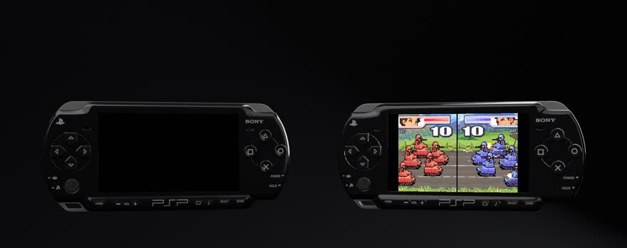
    </picture>
  </a>
  <br>
  <sub><b>Two PSPs, one game.</b> Mario Kart: Super Circuit, Advance Wars 2 and a Pokémon Crystal trade, linked over the PSP's own WiFi. <a href="gpsp/docs/video/trailer-3.5.0.mp4">Watch the 86-second trailer</a></sub>
</p>

Race a friend in Mario Kart, fight them in Advance Wars, trade Pokémon across Game Boy
generations: this release links two PSPs the way a cable links two Game Boys, for
Game Boy Advance games as well as Game Boy and Game Boy Color. And for one player
there is a new in-game menu over your paused game, save states you can see, every button
remappable, sharper pixels, and a quit to the game list that takes about a second.

It still runs the hard ROM hacks at full speed on a PSP-1000, because the renderer lives
on the console's second processor, and you can still put the PSP to sleep and pick the
game up tomorrow exactly where it was.

<br>

<table>
<tr>
<td width="33%" valign="top">
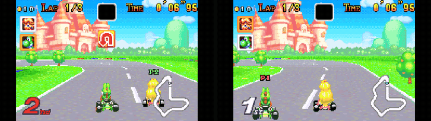
<b>GBA link cable, over the air</b><br>
<sub>Link-cable games between two PSPs. Each PSP runs both games; only the buttons cross the air. Mario Kart: Super Circuit, Advance Wars 2 and more.</sub>
</td>
<td width="33%" valign="top">
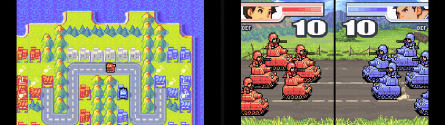
<b>Battle head to head</b><br>
<sub>The other player's moves play out on your screen, battle animations and all, exactly as two GBAs on a cable would show them.</sub>
</td>
<td width="33%" valign="top">
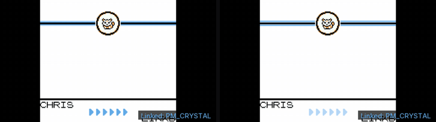
<b>Game Boy trades</b><br>
<sub>Red, Blue, Yellow, Gold, Silver, Crystal: trade and battle like two Game Boys. Only one of you needs the cartridge.</sub>
</td>
</tr>
<tr>
<td valign="top">
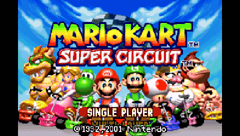
<b>A menu over your game</b><br>
<sub>The game pauses behind it. Five save states with a picture and a time each; delete the ones you don't need.</sub>
</td>
<td valign="top">
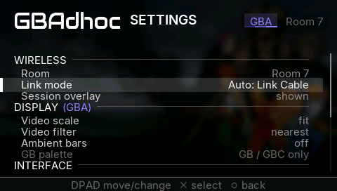
<b>Every button, your way</b><br>
<sub>Remap the game buttons and every shortcut, or leave one blank to turn it off. HOME can open the menu.</sub>
</td>
<td valign="top">
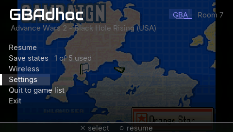
<b>Straight back to your library</b><br>
<sub>Quit to game list is back in the browser in about a second, no relaunch, with your save written first.</sub>
</td>
</tr>
</table>

---

## What's new in this release

Everything below is new since 3.0.0, including what the 3.1.0 beta previewed. Each item
carries a <kbd>NEW</kbd> mark so you can tell it from the features that were already
there.

### <kbd>NEW</kbd> GBA link cable between two PSPs

<p align="center">
  
</p>

The GBA's link-cable games, between two PSPs, with no cable: race in **Mario Kart: Super
Circuit**, fight in **Advance Wars 2**, and more. It works the way the Game Boy link from
the 3.1.0 beta does: **each PSP runs both games**, and only the buttons cross the air
([how that works](#link-cable-how-it-works)).

- **Host, join, play.** Open the game on both PSPs. On one, *Wireless → Host*: the room
  opens and **you keep playing while you wait**. On the other, *Wireless → Join: scan for
  rooms* and pick it. The LINKING screen walks through *Checking the game*, *Sharing
  where you are* and *Starting together*, and **both games carry on from where they
  are**: nobody has to start over.
- **You see each other play.** Your friend's moves play out on your screen exactly as two
  GBAs on a cable would show them, battle animations and all.
- **Safe by design.** Every four seconds the two PSPs compare a fingerprint of both
  games. If they ever disagree, the link ends and **nothing is saved**. An agreed end
  says *Link ended. Game saved.* If the other PSP leaves, *your game carries on*.
- **What you need:** the **same ROM** on both PSPs (same version, same hack) and the same
  GBAdhoc release. Two players.
- **Tested on two real consoles**, a PSP-3000 hosting and a PSP-1000 joining: Advance
  Wars 2 at 58.5–59.8 fps and a Mario Kart: Super Circuit two-player race at 58.4–59.0 fps. Also
  run in pairs of emulated consoles, with jitter and packet loss: Sonic Advance, Mario
  Tennis: Power Tour, and Pokémon Emerald's Cable Club trades and battles.

### <kbd>NEW</kbd> Game Boy and Game Boy Color link cable

<p align="center">
  
</p>

Trade and battle between two PSPs, just like two Game Boys and a cable. Tested with
Pokémon Red, Blue, Yellow, Gold, Silver and Crystal trades and battles.

- **Only one PSP needs the game.** If your friend doesn't have the cartridge, it is sent
  over for the session, kept in memory only, and never written to their Memory Stick.
- **Safe by design.** The two PSPs keep comparing a fingerprint of both games. If they
  ever disagree, the session stops and **nothing is saved**, so no Pokémon goes missing.
  At the end each PSP saves only its own game.
- A slow moment on the radio causes a brief pause, never a desync.

### <kbd>NEW</kbd> A new in-game menu

<picture>
  
</picture>

- <kbd>NEW</kbd> **It opens over your paused game,** which stays behind it, dimmed:
  **Resume · Save states · Wireless · Settings · Quit to game list · Exit.** Hold
  START+SELECT for about ¼ s, as before, or make it HOME (below).
- <kbd>NEW</kbd> **Save states you can see.** Five slots, each with a picture of the
  moment and the time you saved it. ✕ loads, □ saves (asking before it overwrites),
  △ deletes (asking first). On the browser's save-state shelf (LEFT on a game), □
  deletes.
- <kbd>NEW</kbd> **Quit to game list takes about a second.** The game is unloaded inside
  the running app and fades into the browser, no relaunch (a fresh boot takes about
  three); your battery save is written first. After a wireless session it relaunches
  as before.
- <kbd>NEW</kbd> **Settings over the game's art.** Opened from the browser with START,
  Settings sits over the selected game's hero art.
- <kbd>NEW</kbd> **A loading screen with the game's art** behind it, and each step of the
  load named as it happens.

<br clear="right">

### <kbd>NEW</kbd> Remap every button


**Settings → Controls → Button mapping.** Remap every game button and the d-pad, and
every shortcut: fast-forward, video preset, quick save and load, screenshot, pause
screen, Mystery Gift and the menu. Leave a binding blank to disable it. The old ✕/○ swap
lives here now, and your choice carries over.

- <kbd>NEW</kbd> **Menu button: START+SELECT or HOME.** In HOME mode, HOME opens the
  in-game menu and START and SELECT go to the game. HOME still shows the system's
  *Quit game?* dialog everywhere outside a game, and holding START+SELECT always closes
  the emulator. START+SELECT stays the default: on the PSP, HOME belongs to the system,
  and taking it over needs kernel-level access, so if you hit any trouble with HOME
  mode, switch back.

<br clear="right">

### <kbd>NEW</kbd> Sharper pictures, per console

<p align="center">
  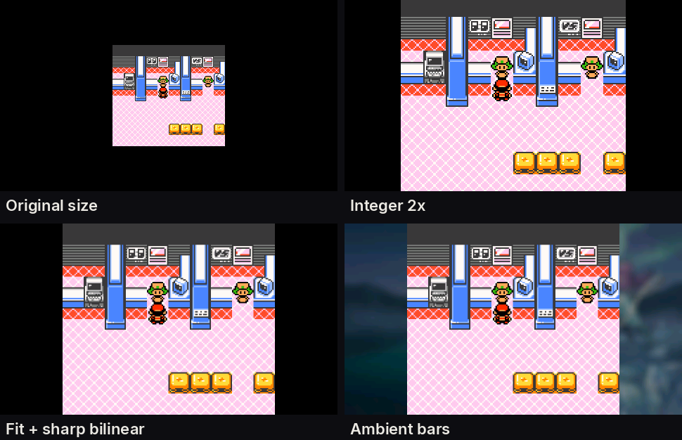
</p>

- <kbd>NEW</kbd> **Each console remembers its own picture.** GBA, GB and GBC each keep
  their own scale, filter, Ambient bars and palette.
- <kbd>NEW</kbd> **Integer 2x** scaling.
- <kbd>NEW</kbd> **Sharp bilinear**: crisp pixels without shimmer at non-integer sizes.
- <kbd>NEW</kbd> **Ambient bars**: the bars beside the picture show the game's own art,
  softly blurred.
- <kbd>NEW</kbd> **More accurate Game Boy Color colours,** modelled on the real GBC
  screen. Crystal no longer looks too dark. `gbc_color_correction = 0` in `config.ini`
  brings the old colours back.

### <kbd>NEW</kbd> Fast-forward, reworked

*Unlimited* runs the game flat out and draws at most 30 frames a second; *Unlimited
Smooth* runs flat out and draws up to 60. Time the PSP used to spend drawing frames it
could never show now goes to the game. *3x* is unchanged, and the chip in the corner
names the preset (`>> 3x`, `>> Unlimited`, `>> Unlimited Smooth`).

### <kbd>NEW</kbd> Faster, and steadier

- <kbd>NEW</kbd> **Dynarec optimisations** make GBA games faster across the board, and
  the emulator's hottest code now sits at a fixed place in the CPU's instruction cache,
  so unrelated changes can no longer make a build randomly slower. Every change was
  checked frame for frame against the previous version on a library of 35 games.
- <kbd>NEW</kbd> **Rare crashes on the PSP-2000, 3000 and Go** are gone, including games
  derailing after loading a state. The cause was the PSP firmware itself: asking the
  system to clear 16 KB or more of the instruction cache silently does nothing, so stale
  code could run. GBAdhoc works around it everywhere.
- <kbd>NEW</kbd> **Audio no longer drifts.** After a few minutes, sound could lag the
  picture by up to ¾ of a second until you opened the menu; it now stays in sync.
- <kbd>NEW</kbd> **Media Engine renderer:** sprite ghosting is gone, and effects that
  change mid-frame (the Sonic Advance 2 title screen) draw correctly.
- <kbd>NEW</kbd> **Joining joins the room you scanned,** and can no longer create a
  second room of the same name by accident (Wireless Adapter sessions too).
- <kbd>NEW</kbd> **Launching a state from the shelf** no longer quits to the XMB when the
  state can't load, and a GB state saved under a different palette now loads.
- <kbd>NEW</kbd> **Waking from sleep** no longer flashes an old game frame before the
  wake prompt, and Game Boy games no longer wake to a blank screen.
- <kbd>NEW</kbd> **`config.ini` is written once and atomically,** with a backup, so a
  power cut mid-save can't leave it half-written.

### <kbd>NEW</kbd> Smaller things

- Game Boy: the faint blur on the screen edge with smooth filtering is gone.
- The fast-forward label shows `>>` again instead of `?`.
- Menu text sits centred in the highlight bar.

<details>
<summary><b>Release history</b>: 3.0.0 and earlier</summary>

### 3.0.0

Game Boy and Game Boy Color on the TGB Dual core, at full speed with sound on every
model, with the same browser, save states and shoulder chords as GBA. The console switch
(△ cycles GBA → GB → GBC), per-console skins, favourites, five save-state slots with the
state shelf, dynarec and Media Engine fixes, PSP-1000 ROM loading, link shedding and
link hold for the Wireless Adapter, startup-sized JIT caches and full ROM residency on
the 64 MB consoles.

### 2.1.0

The Pokémon sound mixer stopped costing a third of the frame (Heart & Soul's heaviest
battle went from 57 to 59.8 fps), and a hard freeze in compiled code was closed, backed
by 36 unattended hardware runs and 1440 save-state reloads without a lockup.

### 2.0.x

Mystery Gift from an Android phone, the three fast-forward presets, the Marquee and Shelf
browsers with box art and hero art, wake from sleep with the Media Engine live, the
translation gates that took Pokémon Unbound from 29 to 59.9 fps, and the wall clock for
the GBA RTC.

The full notes for each are on the
[releases page](https://github.com/ShoshinFauteux/GBAdhoc/releases).

</details>

---

## Playing together

Two PSPs, two ways to link them, both over the PSP's own ad-hoc WiFi: no router, no
Internet, no cable.

| Mode | For | What crosses the air |
|---|---|---|
| **Link Cable** <kbd>NEW</kbd> | GBA link-cable games, and every GB/GBC link game | only the buttons each player presses |
| **Wireless Adapter** | Pokémon Emerald, FireRed and LeafGreen through the AGB-015 adapter | the adapter's radio traffic |

**The game picks the mode.** *Settings → Link mode* shows what the game will use:
*Auto: Link Cable*, *Auto: Wireless Adapter*, or *Auto: ask* for the games that do both
(Pokémon Emerald, FireRed and LeafGreen, Mega Man Battle Network 5 and 6, Mario Tennis:
Power Tour), which ask *How will the other PSP connect?* when you host. You can override
it per game; the choice is kept in `roms/linkmode.txt`. Games that only link through the
adapter (Mario Golf: Advance Tour among them) stay on the adapter.

### Link Cable: how it works

<p align="center">
  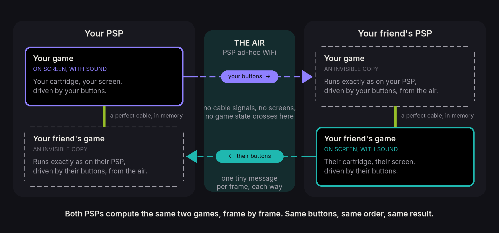
</p>

A real link cable answers in microseconds; PSP WiFi answers in milliseconds. Sending the
cable over the air can't work, so GBAdhoc doesn't. **Each PSP runs both games**: yours,
the one you see and hear, plus an invisible copy of your friend's, and the two are
joined by a perfect cable in memory. The only thing that crosses the air is **which
buttons each player pressed**, one tiny message per frame (about 2.4 KB a second). Both
PSPs get the same buttons in the same order, so they compute exactly the same race,
battle or trade. No game needs special code for it: if it links by cable, it can link
this way.

Game Boy links work the same way, with one difference: **only one PSP needs the
cartridge.** If your friend doesn't have it, it is sent over for the session (*Receiving
… MB*), kept in memory, checked, and never written to their Memory Stick.

### Starting a link

1. Open the game on both PSPs (for Game Boy, only the host needs it).
2. **Host:** in-game menu → *Wireless* → *Host*. A toast says *Hosting Room 7 by Link
   Cable. Waiting for the other PSP.*; keep playing.
3. **Join:** in-game menu → *Wireless* → *Join: scan for rooms*, and pick the room. Or
   *Join room* to go straight to a room number.
4. The LINKING screen runs once on both PSPs, then you're in. The chip in the corner reads
   *Link Cable · Room 7 · P1* on the host and *P2* on the joiner.

Rooms are numbered 0 to 99; yours is under *Settings → Room* (Room 7 unless you change
it). In the scan list, a room you can't enter is dimmed, and ✕ on it says why (*Room 3 is
playing Mario Kart Super Circuit. Open it to join.*).

<table>
<tr><td width="34%">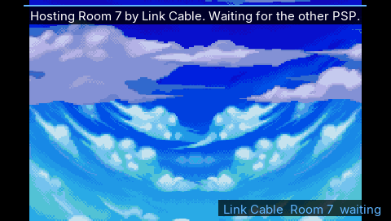</td><td width="33%">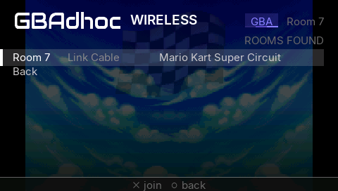</td><td width="33%">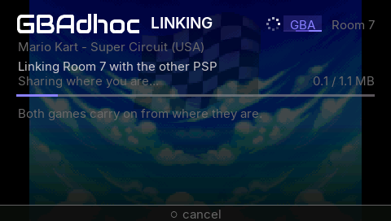</td></tr>
<tr><td><sub><b>Host</b>, and keep playing.</sub></td><td><sub><b>Join</b>: the rooms in range.</sub></td><td><sub><b>LINKING</b>, once, then play.</sub></td></tr>
</table>

<details>
<summary><b>If a link won't start</b></summary>

| The PSP says | What to do |
|---|---|
| *The games do not match: a different version or hack.* | Both PSPs need the same ROM. |
| *The other PSP runs a different GBAdhoc version.* | Update both PSPs to the same release. |
| *Room 7 is full: 2 players.* | Wait for a seat, or host your own room. |
| *Room 7 not found - is the host still there?* | Have them host again, then rescan. |
| *Nobody joined Room 7.* (Game Boy) | Host again when the other PSP is ready. |
| *The link could not start: not enough memory.* | Quit to the game list, open the game, try again. |
| *Room 7 is a Wireless Adapter room. This game links by cable.* | The host picked the adapter; host or join by cable instead. |

</details>

### Wireless Adapter

The AGB-015 Wireless Adapter is emulated in full (that work is
[davidgfnet's](#credits-this-project-stands-on-other-peoples-work)); GBAdhoc carries its
radio traffic over the PSP's ad-hoc WiFi with a reliable transport of its own. Union Room
trades, link battles (singles and doubles), the Trade Center and Mystery Gift, between
any of Emerald, FireRed and LeafGreen. Link sessions are paced to 59.73 fps on both
consoles, because Gen-3 games count link timeouts in *frames*. At each battle menu the
games themselves pause for about a second while both consoles sync, exactly as they do
through the real adapter.

<p align="center">
  <picture>
    <source srcset="gpsp/docs/img/link-demo.webp" type="image/webp">
    
  </picture>
  <br>
  <sub><b>Real hardware, no cables:</b> a PSP-1000 and a PSP-3000 trade over the emulated Wireless Adapter, then fight a link double battle. <a href="gpsp/docs/video/link-demo.mp4">MP4</a></sub>
</p>

### ⚠ Read this before you link two PSPs

**1. The physical WLAN switch must be ON.** It is in a different place on every model,
and the PSP Go has no switch at all, it is a setting. If it is off you get a message that
says so.

**2. Both consoles must be on the SAME FIXED ad-hoc channel, not "Automatic".**
GBAdhoc uses the channel the XMB sets under `Settings → Network Settings → Ad Hoc Mode`.
Pick **1**, **6** or **11** and set the same one on both consoles, and pick one that is
*away from your router*. "Automatic" lets the two consoles choose different channels,
and two radios on different channels cannot hear each other no matter how correct
everything else is.

**3. Start the session from the in-game menu**, *Wireless*, on both PSPs. Save states are
locked while a session is live, because a mid-session load would desync both games.

---

## Mystery Gift

Gen-3 Mystery Gift works, from an Android phone. The phone stands in for Nintendo's
distribution station, and the game receives a real Wonder Card through its own Mystery
Gift menu; nothing is written into your save by the emulator.

**Get the app:** [**Mystery Gift Station**](https://github.com/ShoshinFauteux/MysteryGiftStation)

1. Open Mystery Gift Station on the phone and pick a gift. The app starts its own
   Wi-Fi Direct access point named **`Mystery Gift`**.
2. On the PSP, in-game, press **SELECT + DOWN**. GBAdhoc joins that access point and
   starts listening; it creates the connection profile itself, so there is nothing to set
   up in the PSP's network settings.
3. In the game, go to **Mystery Gift** on the title screen and receive the card as you
   normally would.

**SELECT + DOWN** again stops it (remappable under *Controls*). Mystery Gift and a link
session cannot run at the same time; the emulator will tell you to stop one before
starting the other. Full protocol notes, the gift list and troubleshooting live in the
app's repository.

---

## Screenshots

New in this release, in the dark theme. The 3.0.0 screens (both browsers, every
console skin, favourites, the state shelf) are unchanged and still apply.

<table>
<tr>
<td width="50%">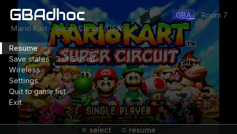<br><sub><b>The in-game menu</b>, over the paused game.</sub></td>
<td width="50%">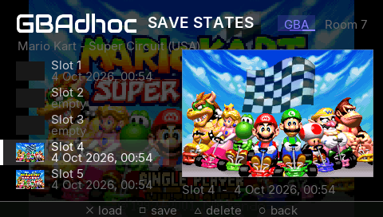<br><sub><b>Save States.</b> Five slots, a picture and a time each.</sub></td>
</tr>
<tr>
<td>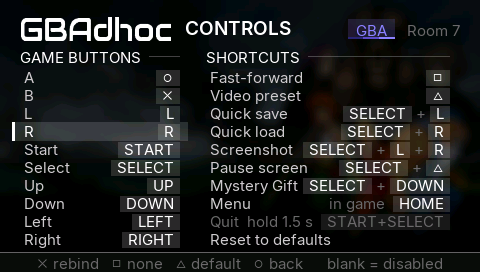<br><sub><b>Controls.</b> Game buttons, shortcuts, and HOME as the menu.</sub></td>
<td>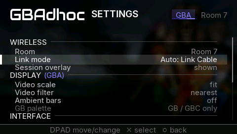<br><sub><b>Settings</b>, over the selected game's art. Room, Link mode, and a display section per console.</sub></td>
</tr>
<tr>
<td>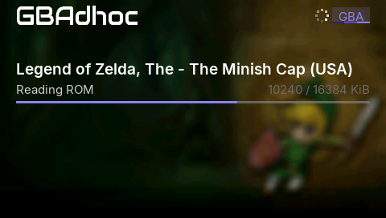<br><sub><b>Loading</b>, over the game's own art.</sub></td>
<td>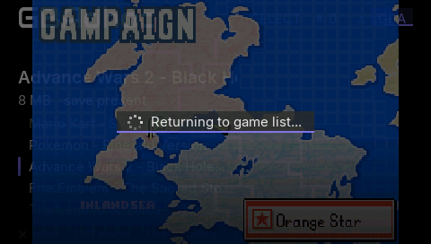<br><sub><b>Quit to game list.</b> The game fades into the library, no relaunch.</sub></td>
</tr>
<tr>
<td>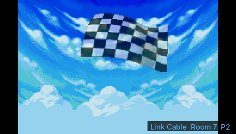<br><sub><b>Linked.</b> The chip says which room and which player.</sub></td>
<td>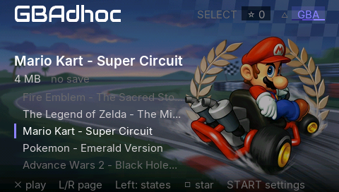<br><sub><b>Marquee</b>, with the game's hero art.</sub></td>
</tr>
</table>

---

## Everything it does

<details open>
<summary><b>The full feature list</b></summary>

**Consoles**
- Game Boy Advance on the gpSP core with its MIPS dynarec and the translation gates that
  make CFRU hacks (Pokémon Unbound, Heart & Soul) run at full speed.
- Game Boy and Game Boy Color on TGB Dual, full speed with sound, with Super Game Boy
  palettes, a GB palette setting and a cartridge real-time clock.
  <kbd>NEW</kbd> GBC colour correction modelled on the real screen.
- No BIOS needed: an open-source replacement is bundled. Drop a real `gba_bios.bin` in
  the app folder if you prefer.

**Playing together**
- <kbd>NEW</kbd> GBA link cable between two PSPs (Link Cable mode).
- <kbd>NEW</kbd> GB/GBC link cable between two PSPs; only one needs the cartridge.
- AGB-015 Wireless Adapter emulation over PSP ad-hoc: Union Room, Trade Center, link
  battles, Mystery Gift.
- Mystery Gift from an Android phone (Mystery Gift Station).
- Save auto-backup before every session; save states locked while linked.

**Performance**
- The renderer runs on the PSP's Media Engine, so both processors work on every frame.
- Three fast-forward presets: **3x**, **Unlimited** (<kbd>NEW</kbd> flat out, at most
  30 frames drawn a second) and **Unlimited Smooth** (<kbd>NEW</kbd> flat out, up to 60
  drawn). Hold or toggle.
- <kbd>NEW</kbd> Dynarec optimisations and a pinned instruction-cache layout.

**The browser**
- Two shells, **Marquee** and **Shelf**, each in **dark** or **light**.
- One list per console, △ to switch with the flare, per-console skins.
- Favourites with □ and SELECT, stored in `roms/favourites.txt`.
- Box art and hero art matched by filename.
- <kbd>NEW</kbd> Settings over the selected game's art; a loading screen with the art.

**Playing**
- <kbd>NEW</kbd> The in-game menu over the paused game.
- <kbd>NEW</kbd> Remap every button and shortcut; HOME as the menu button if you want it.
- <kbd>NEW</kbd> Per-console picture: scale (1x, fit, stretch, integer 2x), filter
  (nearest, bilinear, sharp bilinear), Ambient bars, GB palette.

**Saving**
- Five save-state slots per game with pictures and <kbd>NEW</kbd> times, the state shelf
  in the browser (LEFT), <kbd>NEW</kbd> delete (△ in game, □ on the shelf).
- Select + L / Select + R for a quick save and load of slot 1.
- Battery saves flushed on exit, on HOME, <kbd>NEW</kbd> on Quit to game list, and
  periodically as you play, with a `.sav.bak` kept. Sleeping never touches the save.

**The console**
- Wake from sleep: slide it shut, flick the switch, come back whenever.
- All three PSP models, tested on hardware. 333 MHz.
- Screenshots to `log/`.

</details>

<details>
<summary><b>In-game controls</b> (all remappable under <i>Settings → Button mapping</i>)</summary>

| PSP (default) | Does |
|---|---|
| D-pad | D-pad |
| **○** | **A** |
| **×** | **B** |
| L / R | GBA L / R |
| Start / Select | Start / Select |
| **□** | Fast-forward (hold by default; preset and hold/toggle in Settings) |
| **△** | Cycle video preset |
| **Select + L** | Quick save, slot 1 |
| **Select + R** | Quick load, slot 1 |
| **Select + △** | Pause screen |
| **Select + Down** | Mystery Gift listener on/off |
| **L + R + Select** | Screenshot |
| **Start + Select**, held ~¼ s | In-game menu (or **HOME**, if you choose it) |
| **Start + Select**, held 1.5 s | Quit |

In *Button mapping*, ✕ rebinds a row (press the new button or chord), □ sets it to
none, △ restores its default. A shortcut can be a chord of up to four buttons, but never
START and SELECT together. Taking a button that another row uses moves it, and the
other row goes blank, which the page tells you. The menus themselves always use ✕ to
confirm and ○ to go back.

</details>

<details>
<summary><b>Settings</b></summary>

| Section | Setting | |
|---|---|---|
| Wireless | Room | Room 0–99 (Room 7 by default) |
| | <kbd>NEW</kbd> Link mode | Auto, Link Cable or Wireless Adapter, per game |
| | Session overlay | show or hide the session chip during play |
| Display <kbd>NEW</kbd> per console | Video scale | 1x, fit, stretch, <kbd>NEW</kbd> 2x (integer) |
| | Video filter | nearest, bilinear, <kbd>NEW</kbd> sharp bilinear |
| | <kbd>NEW</kbd> Ambient bars | off, art, art else game |
| | GB palette | Auto, Grey, DMG green, Pocket |
| Interface | Theme | dark or light |
| | Menu style | Marquee or Shelf |
| Gameplay | Fast-forward | 3x, Unlimited, Unlimited Smooth |
| | FF button (Square) | hold or toggle |
| | FPS counter | on or off |
| Controls | <kbd>NEW</kbd> Button mapping | every button and shortcut; the menu button |

The *Display* section is labelled with the console it applies to (*DISPLAY (GBA)*, *(GB)*
or *(GBC)*): from the browser it edits the highlighted game's console, in game the
running one. A few more keys live only in `config.ini`: `quick_return = 0` brings back
the old relaunching Quit to game list, `gbc_color_correction = 0` the old GBC colours,
`loading_art = 0` a plain loading screen, and `gblink_delay` (1–30 frames, default 4)
the Game Boy link's input delay.

</details>

<details>
<summary><b>Where things are saved</b></summary>

- **Battery saves**: `roms/<game>.sav` for GBA, `roms/<game>.gb.sav` and
  `roms/<game>.gbc.sav` for Game Boy. A `.sav.bak` is kept.
- **Save states**: `roms/<game>.st0` … `.st4`, and `.gb.st0` / `.gbc.st0` … likewise,
  each with a `.thumb` beside it and, <kbd>NEW</kbd>, a `.shot` (the full-size picture on
  the Save States page).
- **Favourites**: `roms/favourites.txt`. <kbd>NEW</kbd> **Link mode overrides**:
  `roms/linkmode.txt`.
- **Screenshots**: `log/`.
- **Settings**: `config.ini` in the app folder.

</details>

---

## Install

1. Download the [latest release](https://github.com/ShoshinFauteux/GBAdhoc/releases/latest)
   and unzip it to the **root of your Memory Stick**. It lands in `PSP/GAME/GBAdhoc`.
2. Put your `.gba`, `.gb` and `.gbc` files in `GBAdhoc/roms/`, loose or in subfolders
   (two levels).
3. Optional: box art in `GBAdhoc/boxart/`, hero art in `GBAdhoc/hero/` (see
   [Artwork](#artwork)).
4. Launch it from the XMB. No BIOS needed.

**Requirements:** a PSP running custom firmware (developed and tested on **ARK-4**);
PSP-1000, 2000/3000 and Go are all tested. To play together: two PSPs, both with the
WLAN switch on, both on the same fixed ad-hoc channel.

**Upgrading:** copy `EBOOT.PBP`, `gbadhoc_me.prx` **and `gbadhoc_home.prx`** over your
install, always all three together. Your `config.ini` carries over, and your settings are
moved into the per-console profiles automatically. Your `roms/`, battery saves and save
states are untouched.

### Artwork

Two optional kinds of picture: **box art**, the small cover in the Shelf layout, and
**hero art**, the full-screen 480x272 backdrop behind Marquee, Settings and the loading
screen. The browser works fine without either. **A picture is matched to a game by
filename and nothing else:**

```
roms/Pokemon - LeafGreen Version (USA).gba
hero/Pokemon - LeafGreen Version (USA).png     <- found
hero/Pokemon LeafGreen.png                     <- silently ignored
```

No database, no fuzzy matching, and a mismatch prints no warning; the game just shows
no art. **If a card is not showing up, the name is wrong.** Same rule for `boxart/`, and
the same for `.gb` and `.gbc` games.

Ready-made packs, a tool that renames a pack to match the ROMs you actually have, and a
script that derives a backdrop from box art are in the art repository:
[**GBAdhoc-heroart**](https://github.com/ShoshinFauteux/GBAdhoc-heroart). The packs are
generated images, not scans and not official artwork, and they are kept out of this
repository because hero art derives from copyrighted box art.

---

## What to expect from which games

<p align="center">
  <picture>
    <source srcset="gpsp/docs/img/psp1000-unbound.webp" type="image/webp">
    
  </picture>
  <br>
  <sub><b>The slowest PSP, the heaviest game:</b> Pokémon Unbound's rival battle on a PSP-1000, FPS counter on. The middle of the fight is sped up 3× for the clip (labelled); the counter shows the real rate throughout. <a href="gpsp/docs/video/psp1000-unbound.mp4">MP4</a></sub>
</p>

| | |
|---|---|
| **Pokémon Emerald / FireRed / LeafGreen** | Full speed. Wireless Adapter trades and battles on real consoles; Emerald's Cable Club by Link Cable in emulated pairs. |
| **Pokémon Unbound** and other CFRU hacks | Full speed (59.9). Run it on the game's **medium music preset** for the best results. |
| **Pokémon Heart & Soul** | Full speed (59.8) including its heaviest battles. Set its sound to **mono** for the best performance. |
| <kbd>NEW</kbd> **Advance Wars 2** | Linked battles between two PSPs, 58.5–59.8 fps on a PSP-3000 + PSP-1000 pair. |
| <kbd>NEW</kbd> **Mario Kart: Super Circuit** | Linked two-player races, 58.4–59.0 fps on the same pair. |
| <kbd>NEW</kbd> **Sonic Advance, Mario Tennis: Power Tour** | Linked play passes in emulated pairs; not yet on two real consoles. |
| <kbd>NEW</kbd> **Pokémon Red, Blue, Yellow, Gold, Silver, Crystal** | Trades and battles between two PSPs. |
| **Mario Golf: Advance Tour** | Its cable link doesn't form, so GBAdhoc offers it the Wireless Adapter instead (not yet tested with it). |
| Most commercial GBA titles | Full speed. |
| Heavy 3D / Mode 7 GBA titles | Varies; fast-forward and frameskip are there if you need them. |
| **Game Boy / Game Boy Color** | Full speed with sound on every model. Shantae is playable but shows glitches on this core. |

---

## Status and known limitations

**Works, tested on hardware, on all three PSP models:** Wireless Adapter link battles and
trades, sleep/wake with the Media Engine live, GB/GBC at full speed, and Quit to game
list (520 returns on a PSP-1000 and a PSP-3000, about a second each, against three for a
fresh boot). <kbd>NEW</kbd> **On a PSP-3000 + PSP-1000 pair:** GBA Link Cable (Advance
Wars 2, Mario Kart: Super Circuit) and the Game Boy link (24 of 24 trade, battle and
cartridge-transfer runs).

**Rough edges, honestly:**

- **Link Cable is two players,** and both need the **same cartridge**: two-cartridge
  pairs such as Ruby with Sapphire can't link by cable (FireRed and LeafGreen still trade
  through the Wireless Adapter).
- **Not yet run between two real consoles:** the GBA Link Cable's menus as a player uses
  them (the hardware runs drove the link directly), the version check, and a third PSP
  finding a room full. They are covered on emulated pairs.
- **On a PSP-1000**, link support keeps about 2 MB less of the cartridge in memory in
  single player (the second GBA's code stays loaded; its working memory is lent back to
  your game until a session starts). A very large cartridge may page from the Memory
  Stick a little more.
- **Sleep waits for a reload to finish.** While a game boots, a link session starts or
  ends, or Quit to game list unloads, the POWER switch is held for that second or two,
  then the PSP sleeps. While joining a room that has just disappeared it can wait up to
  about 15 seconds.
- The wake prompt appears a beat after the screen lights: the LCD shows video memory the
  instant it powers on, and we blank it at suspend, so you get black then the prompt.
- Wireless Adapter sessions are paced to 59.73 fps on both consoles.
- HOME as the menu button needs `gbadhoc_home.prx` beside the EBOOT; without it you get
  a message and START+SELECT keeps the job.
- Hero art is not included in this repository; see
  [GBAdhoc-heroart](https://github.com/ShoshinFauteux/GBAdhoc-heroart).
- Single-core rendering is **deprecated** but kept for diagnostics (`me_mode = 0`).
- If a game ever faults, it is reset with a short message (*Emulation fault, game was
  reset*) and your battery save stays in memory. If the PSP itself ever faults, the
  screen shows a diagnostic page; a photo of it is the most useful thing a bug report can
  carry.

---

## The second processor

The PSP has two CPUs. The second one, Sony's Media Engine, sits idle in almost every
homebrew emulator; GBAdhoc gives it the entire GBA renderer.

A GBA screen is 160 lines drawn top to bottom, and the instant line 160 is done the
picture is final; nothing the game does for the rest of the frame can change it. But the
console still has the whole vblank period before it has to show anything. So the drawing
is handed over at line 160 and both processors work at once for the remainder. The Media
Engine's first act is to take a private copy of what it needs, which releases the main
CPU to start the next frame instead of waiting, and it copies only the video memory the
game actually wrote, typically 8 KB of 96 KB, tracked by a per-page map. The emulator
gets roughly 750 microseconds of every frame back.

---

## Building from source

Docker supplies the toolchain, so the build is reproducible on any machine.

```bash
# one profile name, one artifact, one manifest
gpsp/tools/build.sh release      # what a player installs
gpsp/tools/build.sh harness      # the hardware test rig
gpsp/tools/build.sh diagnostic   # release plus instruments
# -> gpsp/psp/EBOOT.PBP
```

The three profiles share the same dynarec configuration deliberately: a diagnostic build
must be the *same emulator* as the release, or it answers a different question. What
differs is the frontend: **release** has telemetry compiled out entirely; **harness**
adds telemetry and the autopilot so a job file can drive a console unattended (titled
*GBAdhoc HARNESS* on the XMB so it is never mistaken for a playable build);
**diagnostic** is release plus instruments that write to the Memory Stick. The GBA Link
Cable is built in with `GBA_LINK=1`. The reproducible release procedure and current flag
set are in [`gpsp/docs/RELEASE.md`](gpsp/docs/RELEASE.md).

## Documentation

- [`docs/ARCHITECTURE.md`](gpsp/docs/ARCHITECTURE.md), how the pieces fit together
- <kbd>NEW</kbd> [`docs/GBA-LINK-MIRROR.md`](gpsp/docs/GBA-LINK-MIRROR.md), the GBA Link
  Cable: both games on each PSP, lockstep, and the hardware results
- <kbd>NEW</kbd> [`docs/GBA-LINK-UI.md`](gpsp/docs/GBA-LINK-UI.md), the link menus, rooms
  and messages
- <kbd>NEW</kbd> [`docs/GB-LINK.md`](gpsp/docs/GB-LINK.md), the Game Boy link and its
  hardware runs
- <kbd>NEW</kbd> [`docs/UI-OVERLAY.md`](gpsp/docs/UI-OVERLAY.md), the in-game menu and the
  Save States page
- <kbd>NEW</kbd> [`docs/CONTROL-REMAP.md`](gpsp/docs/CONTROL-REMAP.md), button mapping
  and HOME as the menu
- <kbd>NEW</kbd> [`docs/DISPLAY-FEATURES.md`](gpsp/docs/DISPLAY-FEATURES.md) and
  [`docs/SHARP-BILINEAR.md`](gpsp/docs/SHARP-BILINEAR.md), the picture settings
- <kbd>NEW</kbd> [`docs/INPROC-RETURN.md`](gpsp/docs/INPROC-RETURN.md), Quit to game
  list without a relaunch
- [`docs/ADHOC-NOTES.md`](gpsp/docs/ADHOC-NOTES.md), the RFU protocol as we found it
- [`docs/DECISIONS.md`](gpsp/docs/DECISIONS.md), every design decision and why, including
  the ones that were wrong
- [`docs/TESTING.md`](gpsp/docs/TESTING.md), the harness
- [`docs/RELEASE.md`](gpsp/docs/RELEASE.md), how a release is built and verified
- [`gbcore/tgbdual/LOCAL-PATCHES.md`](gpsp/gbcore/tgbdual/LOCAL-PATCHES.md), every change
  to the Game Boy core

## Credits, this project stands on other people's work

**Everything that makes wireless multiplayer possible was built by other people. We wrote
a PSP shell and a radio transport around it.**

- **David Guillen Fandos (davidgfnet)**, maintainer and principal author of the modern
  gpSP core. He **reverse-engineered the GBA Wireless Adapter and implemented its
  emulation** (`rfu.c`, `serial_proto.c`), which is the single hardest and most valuable
  piece of this entire stack. His write-up:
  <https://www.davidgf.net/2024/01/13/gba-wireless-adapter/>. Repo:
  <https://github.com/davidgfnet/gpsp>.
- **Hii**, author of **TGB Dual**, the Game Boy / Game Boy Color emulator that runs the
  `.gb` and `.gbc` games; it was built to run two Game Boys joined by a cable, which is
  exactly what each PSP does in a Game Boy link. And **Brunni**, whose **MasterBoy**
  ported it to the PSP (with
  earlier PSP work by LCK, ruka and RIN) and made it fast enough for full speed. GBAdhoc
  vendors MasterBoy's core only, with its changes listed in
  `gbcore/tgbdual/LOCAL-PATCHES.md`. Its Super Game Boy support descends from **GEST**
  (TM) and **VisualBoyAdvance** (Forgotten). All GPL v2 or later.
- **mcidclan (m-c/d)**, the reason sleep/wake works at all. The PSP cannot resume with
  custom code on the Media Engine, because the kernel's own ME driver owns a system
  event handler that runs during suspend and finds hardware it no longer understands.
  His libraries identified and solved this, and GBAdhoc uses his mechanism (MIT):
  [psp-media-engine-custom-core](https://github.com/mcidclan/psp-media-engine-custom-core)
  and [psp-media-engine-safe-task](https://github.com/mcidclan/psp-media-engine-safe-task).
- **ShoshinFauteux**, project lead. Set the direction, ran every hardware test on three
  consoles, pushed for sleep/wake after being told it probably was not worth the risk,
  designed the wake prompt, and reported what actually happened, including the times it
  contradicted what a build was meant to prove.
- **Rodrigo Alfonso (afska)** and **Corwin (kuiper.dev)**, the community protocol work on
  the Wireless Adapter that the emulation is built on and cross-checked against:
  [gba-link-connection's `wireless_adapter.md`](https://github.com/afska/gba-link-connection/blob/master/docs/wireless_adapter.md)
  and [blog.kuiper.dev/gba-wireless-adapter](https://blog.kuiper.dev/gba-wireless-adapter).
- **libretro/gpsp**, the upstream repository this is forked from
  (<https://github.com/libretro/gpsp>), including its MIPS32 dynarec (which is why a PSP
  can run this at all), the rewritten video renderer, and the bundled open-source BIOS
  replacement. gpSP itself descends from **Exophase**'s original gpSP and **notaz**'s fork.
- **The libretro project**, the `retro_netpacket_callback` interface (env call 78) that
  lets a frontend carry a core's link traffic over any transport it likes.
- **pret** (`pokeemerald` / `pokefirered` decompilations), used to understand game-side
  RFU behaviour while debugging the input-eating gates.
- **PSPSDK / pspdev**, the toolchain and the `sceNetAdhoc` documentation-by-source.
- **Inter** by Rasmus Andersson (SIL Open Font License), the UI typeface.
- **The PSP in the renders** on this page is
  [*Sony PSP*](https://sketchfab.com/3d-models/sony-psp-dca89d10ec304d0cab76837750df7761)
  by [Ilya Ostrovsky](https://sketchfab.com/strov), licensed
  [CC BY 4.0](https://creativecommons.org/licenses/by/4.0/); modified: re-lit, screen
  replaced with GBAdhoc footage. The renders, the trailer included, are ours; the game
  content on the screens is the games'.

Licensed **GPL-2.0**, same as gpSP (see `COPYING`). Upstream copyright headers are intact.
Changes to the core itself are kept minimal and are intended to be offered upstream.

## License

GPL-2.0. See `COPYING`.
