# Link Cable or Wireless Adapter: the player's link menus

Branch `claude/gbalink-ui` (from `claude/gbalink-hw` + `claude/splash-logo`), 2026-10-03.

The GBA link mirror (docs/GBA-LINK-MIRROR.md) started only from harness keys.
This is the player's way in: the Wireless menu hosts and joins Link Cable rooms
as well as Wireless Adapter rooms, and the game decides which. The design is
Fable's study in `builds/linkmode-mockups` (README, `linkmode.py`, `png/`,
published at https://claude.ai/artifact/KVU9vwV1JRW5pauVPydESz); this
implements it, with the owner's answers to its open questions.

**Contents.** 1 What the player sees. 2 How it works. 3 Files. 4 The owner's
answers and my choices. 5 Deviations from the design. 6 Verification.
7 Harness keys and the rig. 8 What needs hardware.

---

## 1. What the player sees

* **The game decides.** `frontend-common/link_games.h` maps the first three
  header bytes (0xAC..0xAE, so every region) to Link Cable, Wireless Adapter
  or both. Unlisted games are Link Cable.
* **Wireless screen.** The Host row's value is the mode Host will use
  (`Host   Link Cable`, `Host   Wireless Adapter`,
  `Host   Link Cable / Wireless Adapter`). Two explainer lines name the game
  and say the one thing to know ("This game has no Wireless Adapter mode.").
  GB/GBC has the same screen without the Mystery Gift row.
* **Host.** Only a game that links both ways asks, on the HOST chooser
  ("How will the other PSP connect?"). Every other game hosts at once.
* **A cable host keeps playing while it waits.** Toast "Hosting Room 7 by
  Link Cable. Waiting for the other PSP.", chip "Link Cable  Room 7
  waiting", the menu header says HOSTING, Wireless shows the status and
  Stop hosting. Save and load states still work while it waits: the link
  starts from the live game whenever the other PSP arrives.
* **Join never asks the mode.** The scan list has three columns, room / mode /
  game. Rooms this game cannot enter are dimmed but listed; X on one puts the
  reason on a plate ("Room 3 is playing Mario Kart Super Circuit. Open it to
  join.", "Room 7 is a Wireless Adapter room. This game links by cable.",
  "Room 5 is a Game Boy room.").
* **Join room N.** A game that can enter only one kind of room joins it by
  name. A game that links both ways (and every GB/GBC game) scans first:
  one Room N found = join it; a Link Cable and a Wireless Adapter Room N =
  ask ("Room 7 is open two ways. Which one?"); none = "Room 7 not found - is
  the host still there?".
* **One LINKING screen** for cable, adapter and GB, in the loading screen's
  style: title LINKING, the busy ring left of the console badge, line 1 what
  is happening, line 2 the step and its amount, the 3 px bar in the console
  colour. Cable steps: Checking the game, Sharing where you are (KB),
  Starting together. GB: Receiving <game> (MB), Exchanging saves. A failure
  replaces the lines; the footer becomes O back.
* **Linked.** Chip "Link Cable  Room 7  P1" (P2 on the joiner); the menu's
  Wireless row says "Link Cable" where it said "linked"; header LINKED;
  save/load states dimmed as before. Adapter: chip "Wireless Adapter
  Room 7".
* **Ending.** Disconnect = an agreed end, "Link ended. Game saved.". A lost
  cable link: **each player carries on and saves as usual** (owner),
  "Link lost: the other PSP left. Your game carries on." A desync: "The games
  fell out of step. Link ended, nothing saved." (back to the link's start).
* **Failures** (LINKING screen, joiner): the games do not match / a different
  GBAdhoc version / the host left Room 7 / Room 7 is full / not enough memory.
  The host of a cable room keeps hosting when a would-be partner fails ("A
  PSP with a different game tried to join.").
* **Settings > Link mode**, between Room and Session overlay, per game:
  `Auto: Link Cable` / `Auto: Wireless Adapter` / `Auto: ask` / `Link Cable` /
  `Wireless Adapter`. From the browser's START settings it edits the
  highlighted game; with none, dimmed "pick a game". Stored in
  `roms/linkmode.txt` beside `favourites.txt`, keyed by the ROM's name under
  roms/ (`Pokemon Unbound.gba = cable`).

## 2. How it works

**Rooms.** The beacon is the 8-byte adhocctl group name, so it carries the
mode and the game (`psp/room_label.h`, `room_parse` / `room_make`):

| group | room |
|---|---|
| `GPSPnn` | Wireless Adapter room nn: unchanged since 1.0, so an older build's "Join room 7" still finds it |
| `GCnnXXXX` | Link Cable room nn, GBA, header code XXXX (non-alphanumeric -> `0`) |
| `GBnnXXXX` | Link Cable room nn, GB/GBC, XXXX = first four alphanumeric bytes of the title, else `GAME` |
| other | shown verbatim, joinable, the handshake decides |

One room number (Settings > Room) for every kind. The netdrv protocol string
(exact match at JOIN) is the version detector: adapter `gpSP v1.0`
(unchanged), GB `GBAdhoc GB link v2` (unchanged), cable **`GBAdhoc cable v1`**
(`fe_np_set_gb_protocol`, new). netdrv ignores a JOIN with another protocol,
so a joiner that gets no WELCOME for 12 s while the room's radio cell is
there is told "The other PSP runs a different GBAdhoc version." (on a GB
console joining a `GPSPnn` room: "Room N is a Game Boy Advance room.").
A WELCOME refused (`ND_STOP_REFUSED`, `fe_np_stop_reason`) is "Room N is
full: 2 players."

**Identity (owner: game code + a quick sampled hash).** A cable session
identifies the cartridge by SHA-1 over its size and 64 slices of 4 KiB spread
evenly over the file (the first holds the header): 256 KiB in 64 seeks
instead of streaming up to 32 MiB (`fe_gblink_local.rom_sampled`,
`fe_gblink.c` SAMPLE_N). Same code is already required by the room name.
Two dumps that differ only between slices pass and are then caught by the
periodic HASH (a desync). Harness `gba_link_rom_full = 1` restores the
whole-file SHA-1.

**Sessions** (`psp/main_psp.c`): `ui_net_action` builds or reads the room
name and sets this session's kind (`g_link_kind`: adapter / cable / GB);
`g_gba_cable` is now per session (it was per boot) and
`g_gba_cable_ok` says this boot can run one. A cable host only brings the
radio up (`g_link_wait`); `gblink_service` starts the session the moment
`fe_np_gb_peer_ready` (the joiner's early HELLO is replayed, as before). A
failed would-be partner leaves the host in `g_link_clear` until it has left
the channel, so the next session cannot start with it. `link_setup_watch`
(O cancel, the joiner's refused/version detection) and `link_end` (what the
player sees next) handle menu sessions; harness `gblink_role` sessions keep
their own path, unchanged.

**Lost link, carry on** (`fe_gbadual.c` `gbadual_finish_local`,
`fe_host.c` `gba_cable_close`). A pair step can stop the player's machine
mid-frame (the partner stalled after A ran part of its next frame), and a
gpSP core leaves cable mode only at a frame boundary. So when the session
stops, the pair runs on until A completes its frame, the partner fed no
buttons (on screen: the cable pulled a few scanlines later than the radio
lost it); then A continues from where it stands and the battery writer
saves as usual. A desync, or a failure before the machines ran, still
restores the pre-link state.

**Boot** (player build with GBA_LINK). For every GBA game instance B is
loaded for sessions (dormant; its JIT is the static small tier), and the
2,560 KiB session reserve is taken unless the game, after its override, is
adapter-only. A harness build does this only with `gba_link_menu = 1`, so
the rigs' runs are what they were.

## 3. Files

| file | what |
|---|---|
| `frontend-common/link_games.h` | the table (30 rows), `link_game_mode/title`; header-only |
| `frontend-common/fe_linkmode.{c,h}` | `linkmode.txt`: parse, get/set, serialise, `fe_linkmode_effective`; static, ~13 KB BSS |
| `psp/room_label.h` | `room_parse`, `room_make`, `room_code_gba/gb`, `room_number`; `room_label` names every kind "Room N" |
| `psp/ui_psp.c` / `.h` | Wireless (by mode), HOST chooser, JOIN ask, hosting/linked status, three-column scan with plates, Settings > Link mode (in game and browser), `ui_linking_draw`, cluster HOSTING/LINKED, menu Wireless row value |
| `psp/main_psp.c` | session kinds, cable host waiting, LINKING composition (`link_draw_facts`), `link_setup_watch`, `link_end`, chips, boot identity and player config, harness `ui_script` |
| `psp/osd_psp.c` | toast buffer 56 -> 72 characters (the hosting toast is 57) |
| `frontend-common/fe_gblink.{c,h}` | `rom_sampled`, `fe_gblink_get_progress` (read-only facts for the LINKING screen), the partner's ABORT reason |
| `frontend-common/fe_gbadual.c` | `gbadual_finish_local` in `m_stop` |
| `frontend-common/fe_host.{c,h}` | carry-on in `gba_cable_close`; `fe_host_gblink_facts`, `fe_host_gba_cable_ready`, `fe_host_gba_cable_rom_sampled` |
| `frontend-common/netpacket_host.{c,h}` | `fe_np_set_gb_protocol`, `fe_np_stop_reason` |
| `tools/test_link_mode.c` | host test (table sorted/unique/titles <= 40, override file, room names); in the `fe_favs` suite (the cap is 30) |
| `tools/gbamirror/run_linkmenu_ppsspp.sh`, `linkmenu/` | the two-PPSSPP menu rig, ui scripts, specs, `make_backdrops.py`, `compare_mockups.py` |

## 4. The owner's answers, and my choices

Owner (2026-10-03):
1. **Lost cable link:** each player carries on, saves as usual. (Section 2.)
8. **ROM identity at host time:** game code + a quick sampled hash. (Section 2.)
6. **Join room N with a cable and an adapter Room N:** ask. (JOIN screen.)
7. **Old 3.1-beta GB-link hosts (`GPSPnn`):** the handshake decides. On a
   GB/GBC console a `GPSPnn` row is lit as "older GBAdhoc / GB link or GBA
   adapter"; Join room N tries it when no `GBnn` room answers.

Mine:
2. **The table's adapter rows.** BOTH: Pokemon FireRed / LeafGreen / Emerald,
   Mario Tennis Power Tour (its cable match passes the multigame matrix), Mega
   Man Battle Network 5 and 6 (cable net battles are their main multiplayer).
   ADAPTER: Mario Golf Advance Tour (the cable never forms on the mirror,
   GBA-LINK-MIRROR.md 16.4), Narnia, LotR The Third Age, Shrek Super Slam,
   Hamtaro Ham-Ham Games, Digimon Racing, DBZ Buu's Fury, No No No Puzzle
   Chailien (adapter mode works; their cable is unvalidated). CABLE rows only
   name games for the scan list (AW1/2, Super Circuit, R/S, Golden Sun 1/2,
   F-Zero, Sonic Advance, MMBN 1/3/4). The override fixes any of it per game.
3. **Library header lookup for unknown scan codes:** no. "another game (XXXX)"
   plus the table's titles; a 1 s scan on a 64-ROM library is not worth it.
4. **Mystery Gift on GB/GBC:** hidden (a GBA cartridge feature).
5. **Middle dot glyph:** no; columns, as drawn.
9. **Adapter rooms keep `GPSPnn`:** yes; the adapter row cannot name its game,
   but every older build can still join by number.

Also:
* **Join and the override.** Join follows the room's name; the override never
  makes Join ask. It does widen which rooms a game may enter, so a hack the
  table gets wrong (an unlisted adapter hack set to Wireless Adapter) can
  join adapter rooms, and Join room N looks for the right kind.
* **The cable host keeps its room** when a would-be partner fails to link,
  and waits for that PSP to leave before the next can link.
* **The GB link's host flow is unchanged** (it waits on the LINKING screen,
  30 s, "Nobody joined Room 7."): it is hardware-validated (hw5 24/24) and
  its session restarts the machines from the battery, so play-while-waiting
  is the GBA mirror's.
* **The session chip hides** under the menus and the LINKING screen (it sat
  on their footer hints; the header cluster carries the state there).
* **Version detection by silence** (12 s without WELCOME while the cell is
  up): netdrv ignores a mismatched JOIN silently, and changing that would
  change the wire behaviour every older build sees.
* **"(up to 15 s)"** on the bring-up frame: a player's join waits 15 s
  (`net_bringup`), not 30.
* **Harness role sessions use the cable protocol too.** Both ends of a
  hardware rig must be built from this branch or later.

## 5. Deviations from the design, measured

Every screen the design draws over a game frame was GE-dumped in PPSSPP with
the design's own frame injected (`ui_backdrop`) and compared with its PNG
(`compare_mockups.py`, counts in RGB565 steps; section 6.2). Where they differ:

| screen | difference | why |
|---|---|---|
| host-choose | the notes right-aligned at 460, not 300 | at 300 "Wireless Adapter" and "the game's wireless mode" overlap (the design's own render shows it) |
| scan-mixed / -wrong-game / -gb-room | Room 9 reads "Golden Sun The Lost Age" | AGF is in the table; the design used it as its unknown code |
| gb-scan | Room 9 (`GPSP09`) lit, "older GBAdhoc / GB link or GBA adapter" | owner's answer 7 |
| connecting-adapter | "(up to 15 s)", no footer hint | the real join timeout; the radio bring-up blocks, so nothing can cancel it |
| connecting-*, gb-connecting | busy-ring dots, bar 2 px shorter | the ring turns with time (design: phase 3); 180/412 KB is 0.437, the design drew 0.44 |
| linked-game, hosting-game, toast-* | the game picture | live frames from the session, not the design's capture; chip and toast are at the design's coordinates |
| toast-lost | "Your game carries on." | owner's answer 1 (the design showed the GB rule) |

## 6. Verification

### 6.1 Two PPSSPP consoles, driven through the menus

`tools/gbamirror/run_linkmenu_ppsspp.sh` (Xvfb :143/:144 in a private
namespace), `ui_script` per console, scored with `score_session.py`.

Builds: harness64 / harness with `GBA_LINK=1` from this branch (EBOOTs
`031bf8ea` 64 MiB, `e1049973` 32 MiB; the final `aeb63200` differs only in the
chip fix of commit "the session chip stays hidden..."). Outputs:
`builds/gbalink-ui-out/runs/<run>/` (logs, GE dumps, `verdict.txt`).

| run | consoles | what was driven | result |
|---|---|---|---|
| `aw2-pair-2` | 3000 model + 3000 model | AW2: c1 Wireless > Host (cable, keeps playing, chip "waiting"), c2 Wireless > Join: scan > Room 7; the RAM-gated 10-round battle on both; c1 opens the menu and Wireless mid-session; the host ends 120 frames after its script | **PASS**: both `gblink_done`, HASH 60/60 both, FINAL `b298b701b913de0d` @ 14624 both, per-frame both machines identical over 29,247 lines |
| `msc-pair-1` | 3000 model host + **PSP-1000 model** join (32 MiB build; reserve taken and freed) | Super Circuit: host by menu, join by scan, Multi-Pak VS race driven from RAM; end 1500 frames after the script | **PASS**: both `gblink_done`, HASH 57/57, FINAL `374b4082512f237e` @ 13820, per-frame identical over 27,639 lines; `host_lap1` f=12314 and `join_lap1` f=12315 on both consoles; the 1000 model had 2.48 MB free while running |
| `aw2-pair-1` | same as aw2-pair-2 (an earlier build) | the host's harness exited at its script's end, mid-session | the joiner: `gblink_failed reason=peer_lost` -> `gblink_resume how=carry_on`, the game kept running, toast "Link lost: the other PSP left. Your game carries on." (**lost link carries on**) |
| `t-wrong` | AW2 cable host + Super Circuit | c2 scan: Room 7 dimmed "Link Cable / Advance Wars 2"; X -> plate "Room 7 is playing Advance Wars 2. Open it to join."; Join room 7 looks for `GC07AMKE` -> "Room 7 not found - is the host still there?" | as designed |
| `t-mismatch` | AW2 + AW2 with one byte changed at 0x200 | c2 joins by scan | sampled SHA-1s differ -> c2 LINKING "The games do not match: a different version or hack." (O back); c1 toast "A PSP with a different game tried to join.", `link_host_keeps_room`, `link_host_clear` once c2 left, chip "waiting" again |
| `t-version` | **older build** (claude/gbalink-hw ebd76a0, `cd68b18f`) hosting `GC07AW2E` by harness role (GB link protocol) + this build | c2 joins by scan | no WELCOME for 12 s with the cell up -> "The other PSP runs a different GBAdhoc version." |
| `t-adapter_new_host` | this build hosts Emerald + **older build** joins by `join = 1 group = GPSP07` | c1 Host -> HOST chooser -> Wireless Adapter | `GPSP07`, both `net_up proto="gpSP v1.0"`, `peer_connected` both sides; chip "Wireless Adapter  Room 7", toast "Hosting Room 7" |
| `t-adapter_old_host` | **older build** hosts FireRed `GPSP07` (`host = 1`) + this build | c2 Join room 7 (FireRed links both ways -> scan) | `wl_join_room cable=- adapter=GPSP07` -> joined, `gpSP v1.0`, `peer_connected` both |
| `t-override` | Emerald with `linkmode.txt` "= cable"; AW2 with "= adapter" | Host on each | Emerald hosts `GC07BPEE` with no chooser ("Link mode: Link Cable (set in Settings)."); AW2 chose `GPSP07` (its radio start then lost the race for PPSSPP's ad-hoc server, launched at the same moment: a rig artifact) |
| `smoke-dark` | one console | AW2: Settings > Link mode through Auto / Link Cable / Wireless Adapter / Auto (linkmode.txt written each time), Host, Wireless while hosting, Stop hosting | as designed |

Not run: a third PSP ("Room 7 is full: 2 players.") needs three consoles; the
rig has two displays. The path is `ND_STOP_REFUSED` (`fe_np_stop_reason`).

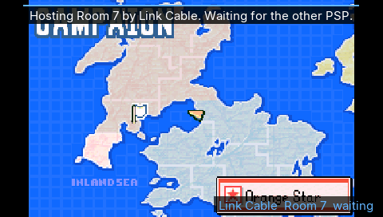 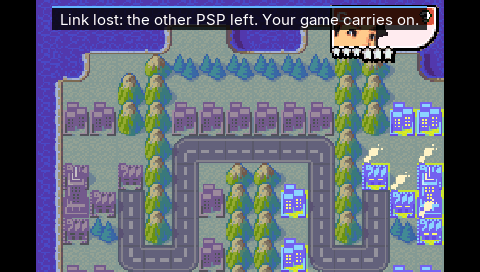
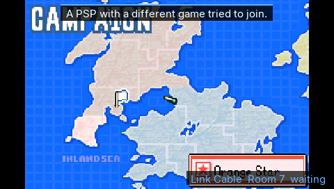 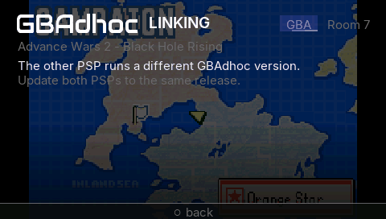


### 6.2 GE dumps of every screen vs the design (both themes)

Final build `aeb63200`, one console per game and theme, the design's frame
injected (`ui_backdrop`, `make_backdrops.py`), walked by
`linkmenu/ge_{aw2,em,gb}.ui` (fake scan lists, `linking` presets for the
LINKING states); `linked-menu` / `linked-wireless` from the AW2 pair with the
same backdrop. Side-by-sides (design | dump | >1-step pixels in red):
`builds/gbalink-ui-out/cmp2/`.

| screen | theme | differ | >1 step | max |
|---|---|---:|---:|---:|
| connecting-adapter | dark | 33958 | 601 | 157 |
| connecting-adapter | light | 54885 | 613 | 124 |
| connecting-cable | dark | 29655 | 79 | 140 |
| connecting-cable | light | 32341 | 79 | 132 |
| connecting-check | dark | 29167 | 73 | 157 |
| connecting-check | light | 31929 | 73 | 157 |
| fail-host-left | dark | 29008 | 1 | 9 |
| fail-host-left | light | 31602 | 1 | 9 |
| fail-rom | dark | 29243 | 1 | 9 |
| fail-rom | light | 31826 | 1 | 9 |
| fail-version | dark | 29273 | 1 | 9 |
| fail-version | light | 31890 | 1 | 9 |
| gb-connecting | dark | 12982 | 75 | 116 |
| gb-connecting | light | 17162 | 80 | 149 |
| gb-scan | dark | 18232 | 1972 | 206 |
| gb-scan | light | 24340 | 2171 | 214 |
| gb-wireless | dark | 13735 | 0 | 9 |
| gb-wireless | light | 17426 | 5 | 17 |
| host-choose | dark | 41291 | 6427 | 140 |
| host-choose | light | 57374 | 6544 | 148 |
| hosting-game | dark | 107193 | 105524 | 255 |
| linked-game | dark | 101747 | 100335 | 255 |
| linked-menu | dark | 29167 | 20 | 17 |
| linked-wireless | dark | 32080 | 243 | 9 |
| scan-adapter-room | dark | 34273 | 15 | 17 |
| scan-adapter-room | light | 38407 | 20 | 17 |
| scan-empty | dark | 31837 | 1 | 9 |
| scan-empty | light | 35379 | 3 | 17 |
| scan-gb-room | dark | 39866 | 1901 | 107 |
| scan-gb-room | light | 59837 | 2324 | 115 |
| scan-mixed | dark | 38621 | 1259 | 107 |
| scan-mixed | light | 54349 | 1258 | 115 |
| scan-wrong-game | dark | 41390 | 1320 | 107 |
| scan-wrong-game | light | 58799 | 1277 | 115 |
| settings-auto | dark | 35014 | 108 | 17 |
| settings-auto | light | 37393 | 3 | 17 |
| settings-override | dark | 35005 | 101 | 17 |
| settings-override | light | 37360 | 3 | 17 |
| toast-ended | dark | 110360 | 109986 | 255 |
| wireless-adapter | dark | 35836 | 36 | 17 |
| wireless-adapter | light | 54258 | 0 | 9 |
| wireless-both | dark | 35704 | 37 | 17 |
| wireless-both | light | 54225 | 2 | 16 |
| wireless-cable | dark | 32495 | 10 | 17 |
| wireless-cable | light | 35980 | 11 | 17 |
| wireless-hosting | dark | 32396 | 243 | 9 |
| wireless-hosting | light | 35478 | 10 | 17 |

Reading it: **`differ`** is everywhere, as in docs/UI-OVERLAY.md 2: PPSSPP's
blend rounding over a photograph. **`>1 step`** at 0-40 is identical
drawing (stacked translucent layers over the picture); 73-108 is the busy
ring's phase and the 2 px bar (connecting-*), the band over Settings'
photograph; the larger counts are the deviations of section 5 (host-choose,
the AGF title, Room 9 on GB, connecting-adapter's text and footer) and the
in-game screens, which are live frames.

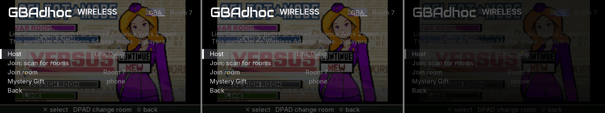
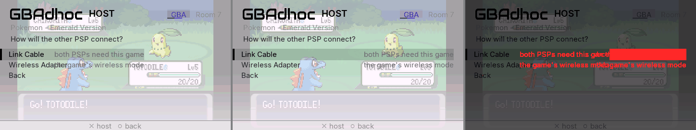
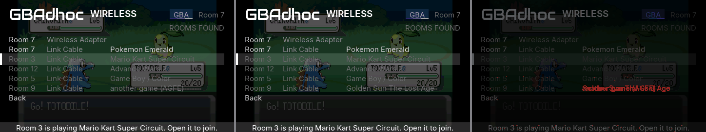
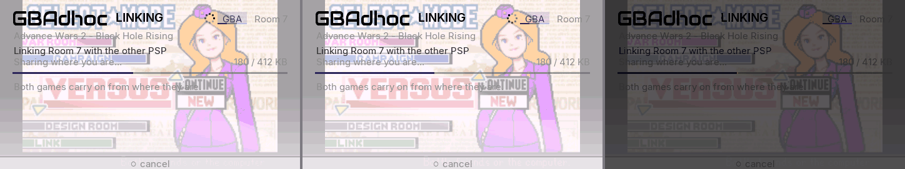
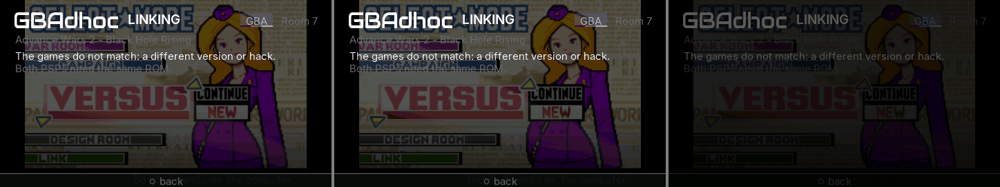
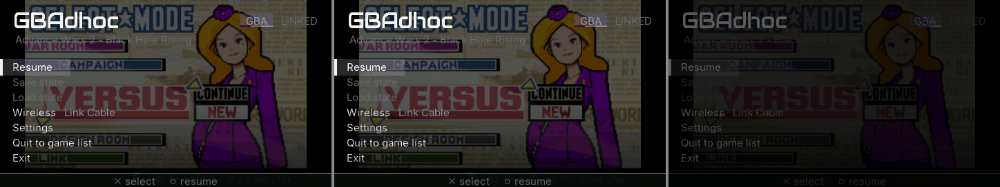
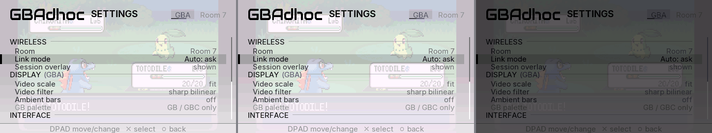
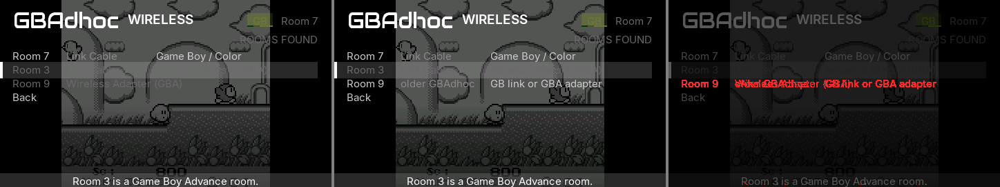


### 6.3 Host tests and single-player identity

* **Host tests:** `python tools/run_host_tests.py` (Windows Python): **30/30
  PASS**, including `gb` (sesssim, bit-identity, linkplay: fe_gblink's
  changes do not move a GB session) and `fe_favs`, which now also runs
  `tools/test_link_mode.c` ("test_link_mode: PASS (30 games)").
* **Single-player frame identity**, AW2 scene tour (the owner's .st0 at frame
  30 + `aw2_psp_script.txt`, 6,061 frames, `shash`, `c=` removed), harness64
  `GBA_LINK=1`:

  | arm | EBOOT | shash vs base | post_load heap |
  |---|---|---|---|
  | base: claude/gbalink-hw ebd76a0 | `cd68b18f` | - | 18,509,752 |
  | this branch | `aeb63200` | **identical, 6,062 lines** | 18,468,792 (-41 KB: linkmode table, BSS) |
  | this branch, `gba_link_menu = 1` (a player build: B loaded, reserve taken) | `aeb63200` | **identical, 6,062 lines** | 15,732,856 (-2.7 MB: the 2,560 KiB reserve) |

  The audio oracle key is not in these builds (`cfg_unknown audio_oracle`),
  so audio was not compared.
* **Release:** `GBA_LINK=1 tools/build.sh release` (the other agent's
  cfb015e allows it) builds and passes the release audit; image 13,048,064 B
  (+16 KB over ebd76a0's link release), PSP-1000 heap at boot 11,048,488 B.
  It boots in PPSSPP to the browser and ran until killed (60 s, no harness).
* **Final builds** from commit ec77330 (clean tree), `builds/gbalink-ui-out/`:
  `final-release` (GBA_LINK=1, EBOOT `19b124fa128fbe3be8d99b56c7deab61`,
  boots in PPSSPP), `final-harness64` (`e8873d936e7e7f6c281cc5d256f35587`),
  `final-harness` (`5f20dcf13d06f0b98b5a85563af05126`). The PPSSPP runs above
  used `aeb63200` / `031bf8ea` / `e1049973`; since then only docs changed.


## 7. Harness keys and the rig

| key | meaning |
|---|---|
| `gba_link_menu = 1` | harness only: load instance B for sessions and take the reserve, as a player build does |
| `ui_script = <file>` | in-game menus driven step by step (`+N menu / press BTN / dump NAME / wait COND / linking PRESET / fakescan LIST / exit CODE`), see main_psp.c |
| `ui_scan_fake = G1,G2,..` | the scan answers with these names ("-" = none) |
| `link_script_waits = 1` | the autopilot waits for the link to run (as `gblink_role` does) |
| `link_exit_after = N` | exit N frames after a menu session ends (0 after an agreed end, 4 otherwise) |
| `gba_link_rom_full = 1` | whole-file SHA-1 instead of the sampled identity (both consoles) |

```
python tools/gbamirror/linkmenu/make_backdrops.py ../gbalink-ui-out/fx
# WSL, in a private namespace (see the runner's header):
bash tools/gbamirror/run_linkmenu_ppsspp.sh OUT tools/gbamirror/linkmenu/aw2_pair.spec   # SCORE=session
python tools/gbamirror/linkmenu/compare_mockups.py CMP OUT1 OUT2 ...
```

## 8. What needs hardware

1. **The whole flow on two real PSPs**, as a player would: Host on one
   (it keeps playing), Join: scan on the other, link, play, Disconnect; then
   a lost link (switch one off mid-game: the other must carry on and save).
   PPSSPP is not a timing source, and the radio's scan/join timing is real
   only on hardware.
2. **The PSP-1000 with the boot reserve in a release:** a large cart
   (16-32 MiB) loses ~2.5 ROM-cache blocks to the reserve in single-player
   (section 2, Boot). Measure paging (`pg=` / page faults) in solo play on
   the 1000; if it hurts, the reserve could be taken only after the player
   opens Wireless (a restart) or the policy changed by the memory owner.
3. **Join timing:** the 12 s "different version" rule and the 15 s join,
   with the real radio's scan.
4. **The look on the LCD**, both themes: the LINKING screen over a dark and
   a bright game, the dimmed scan rows, the plates.
5. **Old builds in the field:** a 3.0/3.1 player joining a new adapter room
   (should be unchanged), and a 3.1-beta GB host joined from a new GB console.

