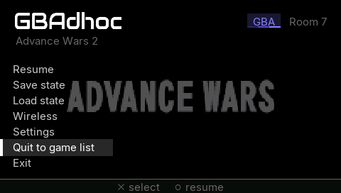
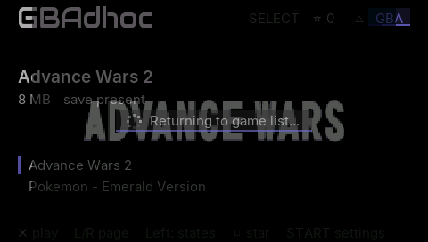
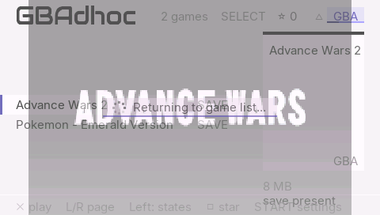
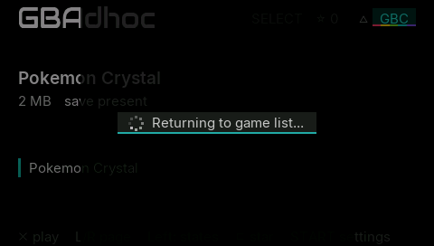
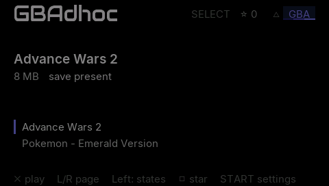

# Quit to game list without a black screen: the in-process return

Branch `claude/inproc-return` (on `claude/splash-logo`), 2026-10-03.

Until now, "Quit to game list" relaunched the EBOOT (`relaunch_eboot` →
`sctrlKernelLoadExecVSHMs2`). The comment explaining why said: *the core
cannot unload a ROM cleanly, and a relaunch flushes SRAM*. The screen was black
for the whole firmware teardown and reload.

This branch unloads the game inside the running process and goes back to the
browser. The last game frame stays on screen with a "Returning to game list..."
chip, and the browser crossfades in over 16 frames. A runtime check confirms
the heap is exactly as it was before the ROM loaded, and if anything is off
the old relaunch runs instead.

**Verdict: feasible and exact in PPSSPP, on both memory models.** Across 20
in-process returns over five games (GBA paged and resident, GB, GBC, all with
state loads), every heap census after an unload is byte-identical to the one
taken before the first ROM loaded. That covers newlib's own counters, the
free-chunk count, the largest block and the kernel partition. Each later
game's frame hashes match a fresh boot of that game. The remaining risks are
hardware-only (§7).

## 1. What a running game owns, and what gives it back

"Exit" never had to free anything: the process ended. The exit teardown in
`main()` already stopped the threads, flushed SRAM, unloaded the ME module and
ran the core's `retro_unload_game` + `retro_deinit`. The in-process return runs
that same teardown and adds the rows marked **new**.

| Owner | What | Released by |
|---|---|---|
| GBA core | ROM page cache: 1 MiB heap blocks up to the cap, or the whole cart when resident (`init_gamepak_buffer`) | `retro_deinit` → `memory_term` (blocks lent from the spare pool are not the heap's and are not freed) |
| GBA core | ROM file (libretro VFS: FILE, 1 KiB stdio buffer, stream struct); the 4 MiB mini-ROM image | `memory_unload_gamepak` |
| GBA core | frame buffer 77,280 B, audio sample buffer 4,392 B | `retro_deinit` |
| GBA core | translation caches, SMALL tier | static `.bss`, nothing to free |
| GBA core | translation caches, LARGE tier: one ~10.5 MiB heap block taken in `retro_init` before the page cache, plus the static SMALL ROM array lent to the page cache as a spare pool | **new** `dynarec_release_translation_caches()`: frees the block, points the caches back at the static arrays, withdraws the spare pool, sets the tier to UNDECIDED. The next `retro_init` decides again on the heap it finds. |
| GBA core | dynarec one-time init: emitter stubs, BIOS hooks, branch hash, dispatch cache, SMC gate table | already re-run on every load (`init_main` → `main_init_dynarec` → `init_dynarec_caches` / `init_emitter`; the gate table resets at ROM load) |
| GBA core | BIOS image | static, reloaded on every load |
| frontend-common | SRAM (.sav) dirty map and file | `fe_host_shutdown`: flush, sync, close (unchanged) |
| frontend-common | core options table (FF and the frameskip policy edit it live) | **new** `fe_host_session_reset()`: back to the first boot's copy |
| GB/GBC core | the instance (core struct, ROM, cart RAM, audio, video frame, sound queue); the save buffer | `gbcore_shutdown`, `fe_host_shutdown` (unchanged) |
| GB/GBC core | TGB's static state. `gb_reset` leaves the sound registers, some CGB registers and the synthesiser's phases from the last game (gbcore.h). In-process, a second Crystal booted with different frames 1-13 than a fresh boot. | **new**: `fe_host_boot` calls `gbcore_power_on()` before every single-instance create. The link session's machines already start this way: every static byte of the instance is restored from a pristine image. |
| GB/GBC core | that image: the instance's one process-lifetime malloc (4,180 B), taken by the first create | **new** `gbcore_prepare()` at boot, so no game takes it |
| GB/GBC core | the video frame: malloc'd per create, not drawn while the boot keeps the LCD off | **new**: cleared at create. A reused block showed the last game's picture; fresh memory is zero. |
| ME | `gbadhoc_me.prx`, a kernel module | `me_host_shutdown` stops and unloads it; the next game's `me_host_init` loads it again |
| ME | renderer buffers: the volatile partition (or the heap if that lock fails); video staging | volatile: kept and reused by the next `me_rend_init`, none of it heap. Heap fallback: **new** `me_rend_suspend()` at unload. Staging: freed in the teardown. |
| HOME | `gbadhoc_home.prx` (Menu = HOME) | `home_host_stop` unloads it; **new** `home_host_forget()` lets the next game load it again |
| threads | SRAM/log writer, stall watch, drprof, priority boost | stopped in the teardown, started again by the next game (`emu_boost_start` is **new** on this path) |
| threads | audio | **new**: stopped, ring, rate and oracle reset, started again (as at boot) |
| netdrv | the 1 MiB arena reserved at boot, with the wake snapshot and the five state thumbnails in its tail | process-lifetime by design, taken before the first census. The hold screen draws from the snapshot. |
| wireless | ad-hoc session, net modules, Mystery Gift's infrastructure modules | not unloaded provably → **relaunch** (§4) |
| UI/OSD/video | in-game menu, toasts and chips, the ambient bake in VRAM | **new** `ui_close`, `osd_reset`, `vid_ambient_drop` |
| main() | per-game values the session edits: renderer wanted, SRAM thread (off for GB), autoload, FF state, pad edges, wake flags | **new**: restored to what boot set before every return |
| CPU caches | the next game's code is emitted into the same translation cache | **new**: whole D writeback+invalidate and I invalidate at unload (PPSSPP models no caches, §7) |

### 1.1 One-time allocations the tracer found

The first census attempt left 1,248 B after a GBA game and 4,192 B after a
GB game. Both were one-time: the second game of each kind came back exact. A
one-time allocation still shifts the heap that every later game loads into,
so each one was tracked down rather than tolerated. `psp/heap_trace.c` is a
link-time wrapper around newlib's allocator (harness builds only, `PSP_EXTRA=
"HEAP_TRACE=1"`). It names every allocation made since the ROM was picked that
is still live after the unload.

| Residue | Bytes | Cause | Fix |
|---|---|---|---|
| `__smakebuf_r` | 1,024 | upstream gpSP's `printf("gamepak code match...")` (AW2, Emerald, ...) made newlib give stdout a buffer for the life of the process | the printf is gone, and stdout is unbuffered from the first line of `main()` |
| `_Balloc` ×3 | 184 | dtoa's Bigint cache, kept forever after the first `%f` (`EVT av_info fps=%.4f`) | integer formatting |
| `image_keep` | 4,180 | the GB core's pristine-`.data` image (above) | `gbcore_prepare()` at boot |
| `__retarget_lock_init_recursive` + `_strdup_r` | 71 | the lock of a FILE opened mid-game that stays open (harness `shash.txt`) | opened at boot |

None of these is a per-game leak. A future one-time allocation of the same
kind cannot do harm either: the runtime check (§3) sees it and relaunches.

## 2. What the player sees

1. **Quit to game list** (the menu, or the wake overlay): the menu goes.
   The picture it sat on stays, scrimmed exactly as the menu had it, with one
   chip in the middle: the loading screen's ring and "Returning to game
   list...". The teardown runs under it, and the ring advances between its
   steps and once per game while the ROM scan runs (`ui_return_tick`, at most
   every 50 ms).
2. The browser's first 16 frames draw the same picture over themselves at a
   falling alpha, a crossfade from the game to the browser. Input waits for
   it. No black frame at any point.
3. **Fallback** (§4): the same hold stays up while the teardown runs, then
   the firmware relaunch blanks it. The new process gets `argv[1] =
   "gamelist"`, and its browser fades in from black over 16 frames instead of
   cutting in.

PPSSPP GE dumps (harness `ret_dumps = 1`, `inproc_via_menu = 1`, the real
browser). Raw dumps are in `builds/splash-out/misc/`.

| the menu's Quit to game list | the hold | crossfade, frame 8 of 16 | after |
|---|---|---|---|
|  |  |  |  |

| hold, light theme | crossfade, light Shelf | crossfade from a GBC game | fallback: fade in from black, frame 8 |
|---|---|---|---|
|  |  |  |  |

In PPSSPP, Quit to the end of the crossfade takes about 1.2 s
(`EVT ui_return fade_done ms=1201..1217`). That includes the SRAM flush, the
ME module's unload, the ROM scan and the 16 fade frames. PPSSPP's I/O is not
the Memory Stick's; the hardware figure is §7's first measurement.

## 3. The runtime check

`heap_snap()` records newlib's `arena`, `uordblks` (live bytes), `ordblks`
(free chunks, i.e. fragmentation) and `fordblks`, the budget figures
(`free`, `largest` by bisection) and the kernel partition (`TotalFree`,
`MaxFree`). It takes one snapshot when the ROM is picked and another after
the unload. `heap_snap_same` compares every field except `arena` and
`fordblks`: those two move with newlib's top trim, and `free` already
accounts for them. Any difference means relaunch, from a state that is
already flushed and torn down. In a release build these functions are
compiled in, and the check costs about 30 malloc/free probes once per quit.

## 4. When it relaunches instead (`inproc_refusal`)

| Reason | Why |
|---|---|
| `config`: `quick_return = 0` in CONFIG.INI | the kill switch (default 1) |
| `build`: `GPSP_INPROC_RETURN=0` | compile-time kill switch |
| `variant` | baked single-ROM installs have no browser to return to |
| `wireless`: any network module was ever loaded (ad-hoc host/join/scan, Mystery Gift, the GB link) | the firmware's net modules, their threads and the heap they touched are not something this proves it can unload |
| `guest_fault`: `badjump_recoveries > 0` | a contained guest fault: do not reuse the process |
| `me_watchdog`: the ME's watchdog declared it dead | the second core's state is unknown |
| `standby`: the console slept during this process | sleep invalidates handles and parks the ME; not proven in-process |
| `census` | §3 |

The wake overlay's "Quit to game list" used to call `relaunch_eboot()`
straight from the loop, skipping the teardown and its SRAM flush. It now
quits the same way the menu does, and with the standby rule that means a
flushed relaunch.

## 5. Census evidence (PPSSPP, Xvfb :142)

The rig is `tools/inproc/` (README there): `batch_x20.sh`, `batch_misc.sh`, `x20_analyse.py`.

Harness keys (`.gpsp-harness.ini`): `inproc_cycles = N`, `inproc_frames = F`
and `inproc_roms = a|b|...` (up to six, relative to `roms/`, cycled). Each
game is booted as `rom =` would boot it, and after F frames the loop quits to
the game list as the menu does. With `inproc_via_menu = 1` the quit is the
menu's own Quit to game list, driven by the UI demo engine. With `browser =
1` each game is picked in the real browser (`ui_browser_script`).
`state_save_at = N` saves slot 1 at frame N. `inproc_force = 1` logs a census
mismatch and carries on (diagnosis only). `ret_fade_in = 1` and
`inproc_fake_net = 1` exercise the fallback visuals and refusal.

**20 returns, five games, both memory models** (`batch_x20.sh`, final code;
`builds/splash-out/x20f-32/` and `x20f-64/`, `analysis.txt` in each). The
games are aw2 → red.gb → emerald → crystal.gbc → hns, four times round, then
aw2. Each loads its slot-1 state at frame 30 and runs 300 frames, and
CONFIG.INI has `menu_button = home`, so the HOME module is loaded and
unloaded with every game. The ME module loads and unloads too: PPSSPP fails
its handshake, which exercises `me_host_shutdown`'s unload.

| model | sessions | returns | refused | census at pre_select / post_select / post_unload |
|---|---|---|---|---|
| 32 MiB (PSP-1000 layout) | 21 | 20 | 0 | one value, all 61: `free=15154632 largest=15147008 used=1055032 chunks=1 kfree=765952 kmax=524288` |
| 64 MiB | 21 | 20 | 0 | one value, all 61: `free=48709064 largest=48701440 used=1055032 chunks=1 kfree=765952 kmax=524288` |

The post-load figures repeat to the byte for each game every time round:
aw2 `free=1439976 largest=966656` on the 1000 layout every time, hns
resident with the LARGE tier on 64 MiB `free=6152904 largest=5169152` every
time. So each game loads into the same heap layout a fresh boot gives it.

**Second-game identity.** Each session's frames are compared with a fresh
boot of the same game, same state, same 301 frames, same binary. GBA
compares `shash` (CPU registers, IWRAM, EWRAM, I/O, palette, OAM, VRAM;
`c=` excluded); every game also compares `vhash` (the presented frame).

| game | sessions | vhash | shash |
|---|---|---|---|
| aw2 | 5 | identical, 301/301 | identical, 301/301 |
| red.gb | 4 | identical | n/a |
| emerald | 4 | identical | identical from the state load on; frames 4-30 differ **exactly as two fresh boots do** (same frames, IWRAM only) |
| crystal.gbc | 4 | identical | n/a |
| hns | 4 | identical | identical from the state load on; frames 11-30 as two fresh boots |

Longer fixtures, one in-process return before each (`builds/splash-out/
ident2/`; red.gb, or crystal then emerald, played first): the AW2 tour (6061
frames) is identical, the H&S heavy battle (3200) and Emerald (2000) are
identical from the state load on, with boot noise as above.

**How the census got exact** (each found by a run, fixed, run again):

| run | result |
|---|---|
| first | GBA +1,248 B, GB +4,192 B, one-time each (§1.1) |
| after §1.1's fixes, no harness oracles | 8 returns exact |
| with `shash = 1` | +71 B: the shash FILE's lock (§1.1) |
| x20, first version | 32 MiB refused once on `arena`/`fordblks` with every other count equal: newlib's top trim. The compare now leaves those two out (§3); 64 MiB had not hit it |
| x20 | crystal sessions 2-4 differed from a fresh boot in frames 1-13: TGB statics `gb_reset` keeps (above) |
| x20, final | the tables above |

**The fallbacks** (`batch_misc.sh`, `builds/splash-out/misc/`):
`quick_return = 0` → `inproc_refused why=config` and the relaunch path.
`inproc_fake_net = 1` → `why=wireless`. Both quit through the same hold.
`ret_fade_in = 1` draws the relaunched browser's fade from black. Two
browser runs with the menu's own Quit to game list (dark Marquee, light
Shelf, GBC) returned in-process with exact census.

Host tests: 30/30 (`python tools/run_host_tests.py`).

## 6. Files

| File | Change |
|---|---|
| `psp/main_psp.c` | `session_top:` before ROM selection; the hold before the teardown; the in-process tail after `fe_host_shutdown` (release, reset, census, `goto session_top`); `inproc_refusal`; `heap_snap` (always compiled); `relaunch_eboot(gamelist)` with `argv[1]`; the wake overlay quits through the teardown; harness keys |
| `psp/ui_psp.c/.h` | `ui_return_hold / tick / fade_in`, the chip, the crossfade in both browser draw sites, `ui_return_dumps`; quit demo script (`ui_controls_demo = 5`) |
| `psp/video_psp.c/.h` | `vid_text_a` (the chip's text through the crossfade) |
| `cpu_threaded.c`, `cpu.h` | `dynarec_release_translation_caches` |
| `frontend-common/fe_host.c/.h` | `fe_host_session_reset`; integer `av_info` |
| `gbcore/gbcore_tgbdual.c`, `gbcore.h` | `gbcore_prepare` |
| `gba_memory.c` | the gamepak-code printf removed |
| `psp/home_host.c/.h`, `psp/me_host.c/.h`, `psp/osd_psp.c/.h` | `home_host_forget`, `me_host_was_dead`, `osd_reset` |
| `netdrv/transport_adhoc.c`, `psp/mgift_net.c` | `gbadhoc_net_touched` |
| `psp/config_psp.c/.h` | `quick_return` |
| `psp/heap_trace.c`, `psp/Makefile` | the allocation tracer (`HEAP_TRACE=1`) |

## 7. What only hardware can answer

**Answered 2026-10-03 for items 1-5 on the PSP-1000 and the PSP-3000:
docs/INPROC-SOAK.md.** 520 in-process returns, 0 refused, census exact
throughout, every session frame-identical to a fresh boot, ME and HOME up
every time, return in about 1.1 s. Items 6 and 7 are not yet run, and the Go
was not tested.

PPSSPP proves the heap and the emulation. It cannot speak for these:

1. **The CPU caches.** PPSSPP models none, and the resident-ROM crash was a
   stale I-cache line (docs/RESIDENT-ICACHE-FIX.md). The return writes back
   and invalidates both caches whole before the next game, and every JIT
   publish still syncs its own range. Check: a long mixed run on the **Go**
   and the **3000** (64 MiB, LARGE tier, H&S resident), e.g. `inproc_cycles =
   100` over aw2/hns/emerald/red/crystal with states, `shash = 1`, then H&S's
   battle fixture after the last return. Expect no `badjump`, no derail, and
   `inproc_return` 100 times.
2. **The real Media Engine.** In PPSSPP the ME's handshake fails, so the
   module loads and unloads but no renderer ever runs. On hardware, each game
   stops and unloads `gbadhoc_me.prx` and the next loads and starts it again,
   with the renderer re-using its volatile-partition buffers. Standby already
   does a version of this; the in-process return does it once per game.
   Check: the same run with `me_mode = 1`, confirming `me_init state=up` and
   `me_rend` frames on every game, and that `kfree`/`kmax` stay equal (the
   census refuses otherwise, which shows as a relaunch).
3. **The PSP-1000's real heap.** Same run, ROMs paged. Expect 0 `inproc_refused`.
4. **HOME module** reload per game with Menu = HOME, on a real console:
   HOME must open the menu in every game.
5. **The look and the time** on the LCD, both themes: the hold, the ring
   moving during the unload and the scan, the crossfade, and the time from
   Quit to the browser compared with the relaunch it replaces.
6. **The fallback** on CFW: quit after a wireless session (or Mystery Gift)
   should show the hold, then black, then the browser fading in. This needs
   `argv[1] = "gamelist"` to survive `sctrlKernelLoadExecVSHMs2` on ARK.
7. **Sleep:** wake, then Quit to game list from the wake overlay. It now
   flushes SRAM and relaunches (the standby rule); before, it relaunched
   without flushing.

The release build carries none of the harness keys. On a release console the
only visible sign of a refusal is the black frame before the browser fades
in.

### 7.1 Builds for those checks (commit bdc4a30, clean tree)

| build | dir | EBOOT md5 | ME prx |
|---|---|---|---|
| release, "GBAdhoc 3.1.0 beta" | `builds/splash-out/inproc-release/` | `2abffabd42e487a96359e42b8cd94c0a` | `19ae57b6` |
| harness (32 MiB layout, PSP-1000) | `builds/splash-out/inproc-harness/` | `83a352ef6032d010ab552282d58cc69a` | `18158678` |
| harness64 (3000 / Go) | `builds/splash-out/inproc-harness64/` | `5601772b28821b3fed5b06eccf9a5caa` | `19ae57b6` |

HOME prx `d3434f4f` in all three.
