# The in-game menu: Fable's Direction A, "Overlay"

Branch `claude/ui-overlay`, based on `claude/candidate-3.1-all` (fa89f4e
merged: sleep/wake fixes, GB palette, sharp bilinear).
Design: `builds/menu-mockups/README.md`, section "A — Overlay". The numbers
are `builds/menu-mockups/mockups.py`, `class Overlay`.

Every in-game screen (menu, save/load state, settings, controls, wireless,
plus the scan and Mystery Gift sub-screens) now draws over the paused game
frame. The frame stays at full fidelity behind a scrim, the wordmark sits in
the top-left, the selection bleeds off the left edge, and a ramp out of the
bottom edge carries the footer. START in the ROM browser opens the same
`screen_settings()`, drawn over the highlighted game's blurred art (§11).

Artifacts:

| | path | sha256 |
|---|---|---|
| playable EBOOT, "GBAdhoc 3.1 RC-ALL+UI" (release profile, commit f24f1ff, clean tree) | `builds/ui-overlay-out/release/EBOOT.PBP` | `cd45000b1dce50b9890e0b87d9a1b5bb1435813b4c09623865ac80a59d1da472` |
| its ME module (unchanged from RC-ALL) | `builds/ui-overlay-out/release/gbadhoc_me.prx` | `ee40522346acc9c5f53351e63f49de8ce0069ec75c54d5e40518244bb83e92ef` |
| harness EBOOT used for every check below | `builds/ui-overlay-out/build/harness/EBOOT.PBP` | `ea83f500b8be8b5ac0bea38400284d9a363d3fefc016892d150b76c98bca6907` |

MD5 of the playable EBOOT: `7ee8e698cb46e326cc86ec943207098c`.

---

## 1. What changed, by file

| file | change |
|---|---|
| `psp/ui_psp.c` | The overlay chrome (`ov_backdrop`, `ov_head`, `ov_cluster`, `ov_band`, `ov_plate`, chips, `ov_scrollbar`) and every in-game screen rewritten on it. Controls page: two columns, chips, plates. Menu: 8-frame opening transition. Slots: thumbnails, read once when the screen opens. Browser START settings: drawn over the browser page. Demo dumps are now taken after the frame is drawn. |
| `psp/main_psp.c` | `menu_open()` takes the wake snapshot and hands it to the UI before every `ui_open()`. The snapshot is stored top-left at its own size (GB/GBC 160x144), with edge texels like the staging buffer. The thumbnail buffer is carved from the netdrv arena's tail. New harness keys `ui_backdrop`, `wake_shot`. |
| `psp/video_psp.c` | `vid_image_screen()` (opaque) draws through `sharp_draw()`/`game_draw()`, the live frame's own code. New `vid_image_px()`. **`vid_clip()` scissor bug fixed** (§6). |
| `tools/ui_model/` | The PPSSPP rig (Xvfb :124, private namespace), fixtures, the model of the implemented screens, and `compare.py`. |
| `docs/CONTROL-REMAP.md` | Screenshots and text for the new chrome. |

Rules did not move: everything about what a binding may be still lives in
`ctl_map.c`, and all 30 host suites pass (`python tools/run_host_tests.py`).

---

## 2. How the pixel match was measured

`tools/ui_model/overlay_model.py` draws each screen the C code draws: the
same calls, in the same order, with the real content (ctl_map's table, the
real Settings rows, the state each harness walker leaves the screen in). It
draws through the design's own renderer model (`pspdraw.py`, the real atlases
and theme words), on `gesurface.py`: the same primitives, but blending in
8-bit integers and writing 565 after every draw call, as the GE does.

PPSSPP draws over the same backdrop as the mockups. The harness key
`ui_backdrop = ui_backdrop.565` draws the mockups' 480x272 game frame 1:1
behind the menu in place of the game. `make_fixtures.py` writes that frame
and the mockups' four state thumbnails as `.thumb` files. The walkers
(`ui_demo`, `ui_controls_demo`) drive every screen and GE-dump it.

```
python tools/ui_model/make_fixtures.py ../ui-overlay-out/fx
# in WSL: DEMO=ui_demo THEME=0 OUT=... UIFX=... bash tools/ui_model/run_ppsspp.sh demo-dark <eboot dir> tools/ui_model/setup_design.sh
python tools/ui_model/compare.py <runs> <out>
```

**Exact identity is not achievable over a photograph, and the reason is
PPSSPP's blend rounding, not the drawing.** Over flat colour the design model
already matched PPSSPP exactly (the mockups README baseline). Over the game
frame I fitted the scrim alone, black at eight alpha levels (the eight frames
of the opening transition), against `out = (c*m + k) >> 8` for every m and k.
The multiplier PPSSPP effectively uses is 256-a at seven of the levels and
255-a at a=170, and no single integer or float formula fits all eight. So the
counts below separate two things:

* **differ**: pixels that differ at all.
* **>1 step**: pixels that differ by more than one RGB565 step in a channel.

Any error in a coordinate, colour, alpha, glyph, clip or draw order puts
pixels in the second column, in solid shapes. Blend rounding cannot, except
where three translucent layers stack (§2.2).

### 2.1 Results, every walker dump, both themes

Thumbnail rectangles are excluded: the GE's bilinear minification of a 64x42
preview to 46x30 is a different resampler from PIL's.

| screen | calls | dark: differ / >1 step | light: differ / >1 step | vs design PNG, >1 step (dark / light) |
|---|---|---|---|---|
| menu, opening frame 4/8 | 21 | 3431 / 0 | 13940 / 0 | - |
| menu | 23 | 4930 / 0 | 49244 / 7 | 21 / 5 |
| save state (slot 3) | 34 | 5347 / 0 | 46234 / 24 | 281 / 828 |
| load state (slot 3) | 34 | 5317 / 0 | 46249 / 24 | 275 / 828 |
| settings (Video scale) | 42 | 13051 / 4 | 16341 / 17 | - |
| wireless | 26 | 8338 / 1 | 48318 / 16 | 39 / 0 |
| settings, Button mapping row | 41 | 12156 / 22 | 15910 / 14 | - |
| controls, defaults | 98 | 13141 / 18 | 15965 / 16 | - |
| controls, Video preset = none | 101 | 13105 / 18 | 16045 / 16 | - |
| controls, capture (Screenshot) | 97 | 13759 / 25 | 15478 / 2 | - |
| controls, chord L+R captured | 98 | 13739 / 22 | 16077 / 16 | - |
| controls, steal plate (A takes Square) | 100 | 12798 / 18 | 15672 / 2 | - |
| controls, reset armed | 100 | 12490 / 18 | 15631 / 2 | - |
| controls, reset done | 97 | 12859 / 18 | 15343 / 2 | - |
| controls, capture (Fast-forward) | 100 | 13189 / 18 | 15422 / 2 | different content (§4) |
| controls, conflict plate | 100 | 13194 / 18 | 15505 / 2 | different content (§4) |
| controls, list (cursor B) | 98 | 13142 / 18 | 15975 / 16 | different content (§4) |

Opening transition frames 1-7, >1 step: dark 2, 3, 0, 0, 0, 0, 217; light
57, 31, 2, 0, 0, 1, 3.

"calls" are the model's draw calls with the backdrop counted as one. In C
the backdrop is the live frame's own path: a clear plus 4 strips (plus up to
4 ambient bars; sharp bilinear about 12). Settings draws only the rows inside
the scissor, so it costs 42 calls rather than the design's 51.

### 2.2 Where the >1-step pixels are

All of them fall in three places, and none forms a shape:

* **The first ~10 rows of the ramp (y 152-161)** where it crosses the scrim,
  a band or a chip. The ramp's per-row alpha is interpolated by the GE, and no
  interpolation rule I tried (truncated, rounded, pixel-centre, h vs h-1) is
  exact. The truncated `a_top + (a_bot-a_top)*i/h` fits best, and all are
  within one step.
* **Glyph edges in the faded rows of the opening transition** (frames 1, 2
  and 7). There the text colour is walked toward the background with
  `mix565` and then blended at partial coverage over a partial scrim.
* **The logo's antialiased edge** (`vid_logo` sampled GU_LINEAR; GU_NEAREST since §12, so this source is gone).

Against the **design PNGs** directly, the menu, wireless and slot screens
agree to within one step everywhere except 5-39 pixels (menu, wireless) and
the ramp/band overlap on the slots screen (275-828 pixels, all in y 152-167
under slot 3's band). The design model blends in float over the unquantised
frame, so it differs from PPSSPP on about 30% of pixels by one step, which is
expected.

### 2.3 Side by side

Each sheet shows the design PNG (where the screen is the design verbatim),
the PPSSPP GE dump, the model, and the diff (yellow: within one step; red:
more than one step).

| | dark | light |
|---|---|---|
| menu | 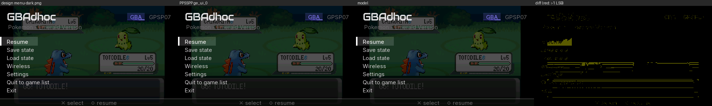 | 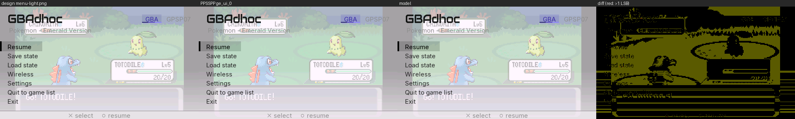 |
| opening, frame 4 of 8 | 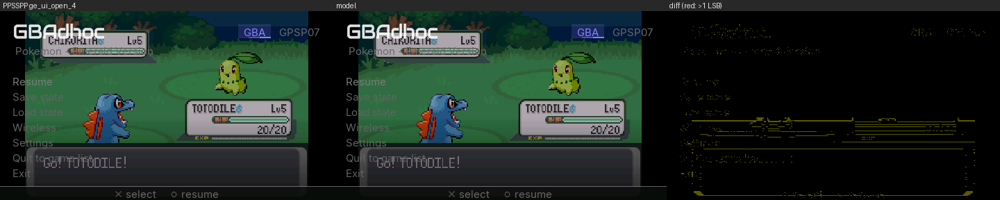 | 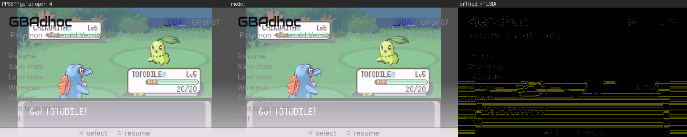 |
| save state | 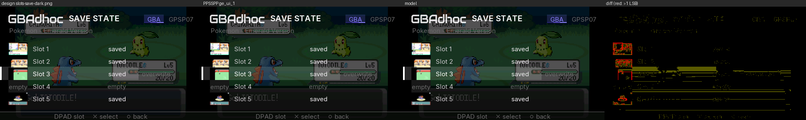 | 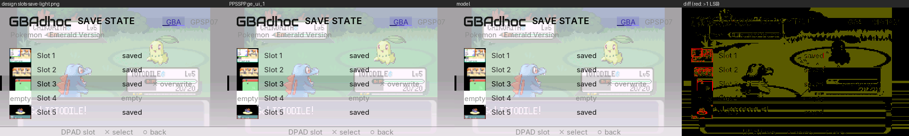 |
| load state | 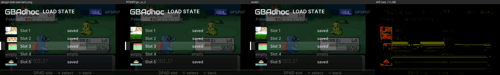 | 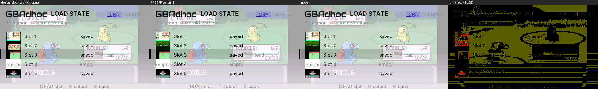 |
| settings | 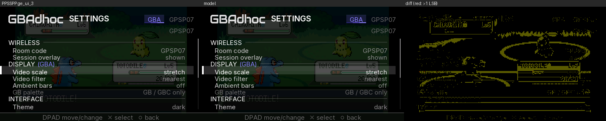 | 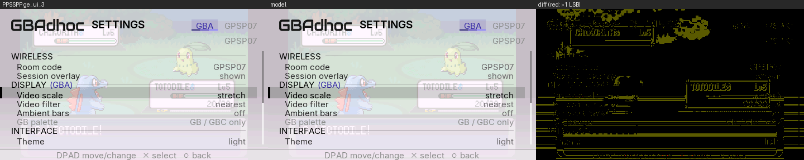 |
| wireless | 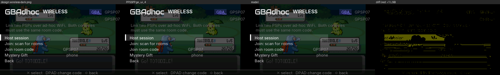 | 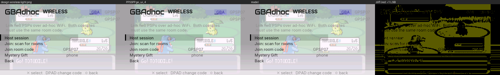 |
| controls | 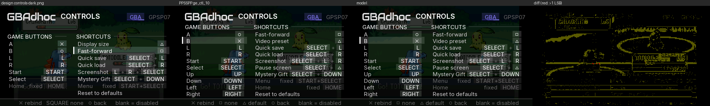 | 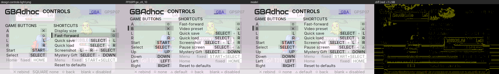 |
| controls, capture |  | 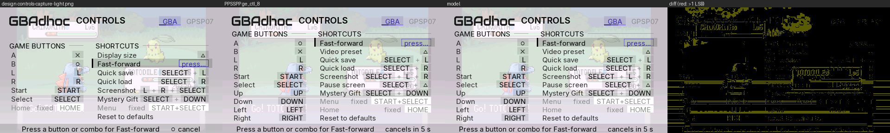 |
| controls, conflict | 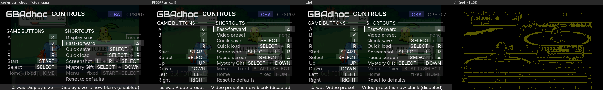 | 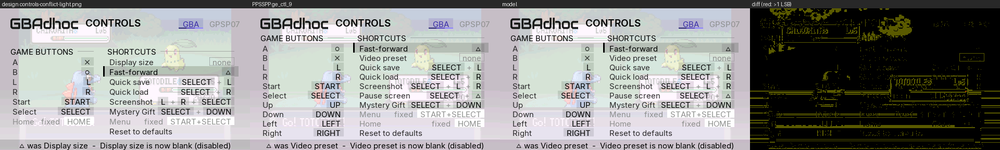 |

More states (PPSSPP dumps):

| | |
|---|---|
| 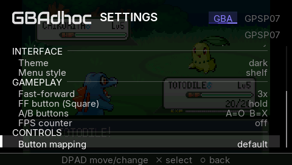 Settings scrolled to CONTROLS | 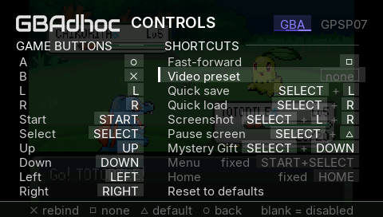 a blank (`none`) chip |
| 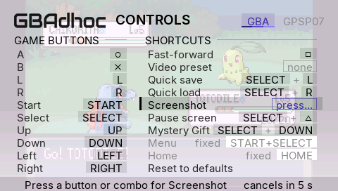 capture on Screenshot | 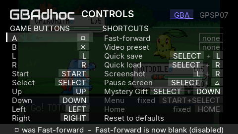 steal plate |
| 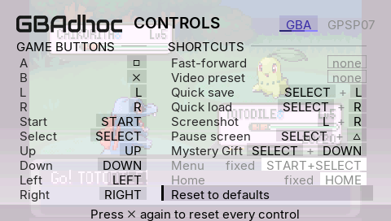 reset armed | 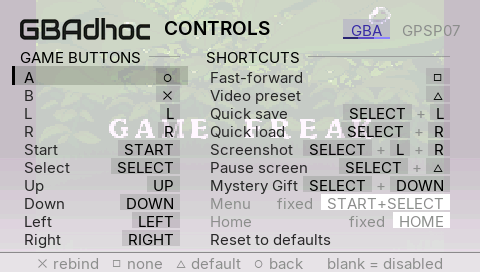 over the real game (light) |
| 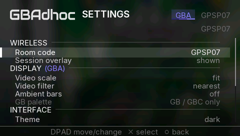 browser START settings, Shelf | 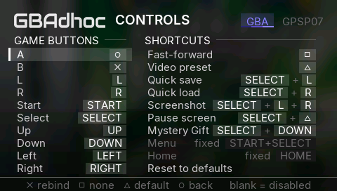 browser Controls, Shelf |
| 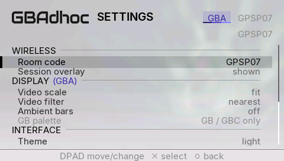 browser settings, Marquee, light | 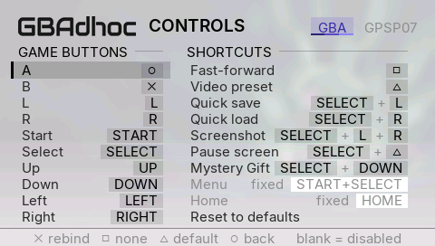 browser Controls, Marquee, light |
| 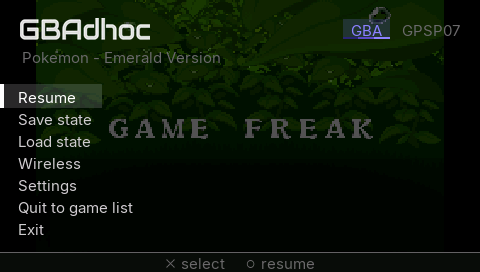 over the real game | 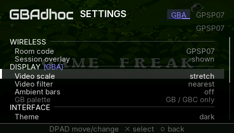 after the walker set Stretch: the backdrop follows |
| 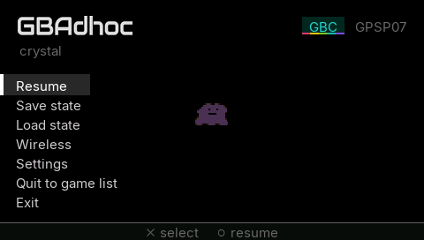 GBC game (160x144 snapshot) | 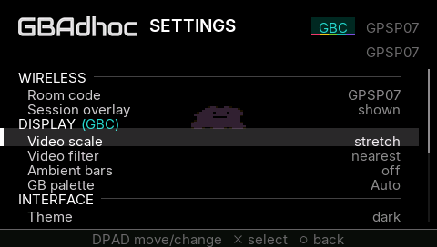 GBC settings, DISPLAY (GBC) |
| 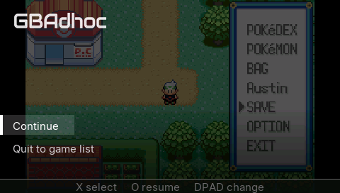 wake overlay, GBA | 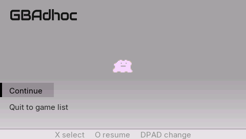 wake overlay, GBC, sharp bilinear |

---

## 3. The backdrop is the live picture, bit for bit

The menu and the wake overlay both draw the snapshot with
`vid_image_screen()`. That now runs the live frame's own code:
`sharp_draw()`, else `game_draw()` with `picture_filter()`, the same 60-texel
strips, REPLACE with blending off, and the same ambient bars. Before, it was
one GU_LINEAR quad, which softened a nearest picture the moment the menu
opened, and a GB frame centred in 240x160 came out smaller than the live one.

Check: harness `wake_shot = N` opens the wake overlay as SELECT+TRIANGLE
would, dumps its third frame, and continues by itself. `gedump_every = 1`
dumps every live frame before it. The live frame, put through the model's
scrim, is compared with the overlay in the scrim-only region (y 60-150).

| run | filter / scale | pixels differing (of 29,700 or 43,200) |
|---|---|---|
| Emerald | nearest, Fit | **0** |
| Emerald | sharp bilinear, Stretch | **0** |
| Crystal (GBC) | sharp bilinear, Fit | **0** |
| Crystal (GBC) | 2x | **0** |

The light-theme GBC run differs on 20 pixels, all within one step. That is
the off-white scrim's blend rounding (§2), not the backdrop.

---

## 4. Deliberate differences from the design, and why

1. **Controls carries the real table, which is longer than the design's.**
   `ctl_map.c` has ten game buttons (the d-pad is remappable) and seven
   shortcuts (it also has Pause screen). The design has six and six. Laid out
   at the design's y0=74 and 19 px pitch, ten rows run off the screen. So the
   column titles sit at y=48 (8 px under the wordmark), rows start at 68, and
   the pitch is computed so the last chip ends by y=246: 18 px for ten rows,
   never more than 19. Home moves under SHORTCUTS with Menu, because GAME
   BUTTONS is full. Labels are ctl_map's ("Video preset", not "Display
   size"), and A defaults to ○ (the design showed the `btn_swap` layout). A
   bisect build's eleventh shortcut row (Crash self-test) gets 16 px.
2. **The capture plate does not say "○ cancel".** O is a legal answer: A is
   on ○ by default, and the rule "a press is the only way out" is
   `CONTROL-REMAP.md`'s. The plate reads *Press a button or combo for
   Fast-forward      cancels in 5 s*, with a live countdown. It is centred on
   the 5-second wording so the digit cannot shift the line. Game buttons read
   *Press a button for A*. While a chord is held, the chip shows it in the
   capture outline and the plate reads *SELECT+L      let go to set*. **The
   owner should decide whether "○ cancel" should become a rule**, which would
   make ○ unbindable alone.
3. **The conflict plate** is the design's sentence with real labels:
   *△ was Video preset  -  Video preset is now blank (disabled)*. The same
   plate also carries refusals (*A unchanged: game buttons take one button*),
   the reset prompt, and the capture timeout. A plain rebind shows no plate,
   because its chip already shows it. The plate clears on the next d-pad press
   and the footer returns.
4. **List footer:** *✕ rebind   □ none   △ default   ○ back      blank =
   disabled*. It uses the □ glyph where the design wrote the word SQUARE, and
   adds △ default, which is a real page action the design left out. The Reset
   row's footer is *✕ reset   ○ back      blank = disabled*.
5. **Navigation:** UP/DOWN walk the rows in the old single-list order (down
   GAME BUTTONS, then down SHORTCUTS), so the harness walker's arithmetic is
   unchanged. LEFT/RIGHT cross to the same row of the other column, or to the
   nearest stop, preferring the row above.
6. **Settings shows the real rows:** DISPLAY (GBA) with its console tag in the
   console colour, Video filter with the third value *sharp bilinear*,
   Ambient bars, GB palette (greyed on a GBA), INTERFACE, FPS counter, and
   *Button mapping* showing default/custom (the design wrote "edit").
7. **Slots:** on an empty slot in Load mode there is no action hint, since ✕
   does nothing there. A state without a preview gets a C_CARD plate reading
   "old", the browser's word.
8. **The opening transition runs on the 8-frame grid** (k/8). The design's
   `transition-*.png` is t=0.45, which is not one of those frames, so frame
   4 (t=0.5) is compared with the model instead.
9. **Screens the design did not draw** use the same language: the linked
   wireless screen (status where the explainer sits), scan, and Mystery Gift.
   During a session the cluster shows LINKED instead of the room ("Room 7", §12), Save
   and Load state are dimmed, and Wireless reads "linked".
10. **Browser START settings** first drew the browser's live page (Shelf or
    Marquee) under the 200 scrim, as the design says ("zero divergence").
    List rows, box art and the browser's wordmark showed through and looked
    messy. Superseded by §11: the highlighted game's blurred art.
11. **Band geometry (2026-10-02, §10):** every band is now placed by the
    text's cap height, not at the design's `y - 4`. The owner asked for it;
    the design is overruled here.

---

## 5. Emulation is untouched: frame-hash identity against candidate-3.1-all

Harness builds of fa89f4e (base, its own detached worktree) and of this
branch, on the standard fixtures, compare every guest-state field `shash`
writes per emulated frame (registers, PC, IWRAM, EWRAM, I/O, palette, OAM,
VRAM, audio). The only field left out is `c=`, the per-frame cost counter,
which is timing.

| run | frames | result |
|---|---|---|
| AW2 tour (aw2.st0 + aw2_psp_script) | 6061 | **identical** |
| H&S heavy battle (heart_soul_heavy.st0 + battle.txt) | 3200 | identical from the state load (frame 30) on; frames 11-30 of the boot differ, **and differ the same way between two base runs**, so it is run-to-run boot noise |
| Emerald, `ui_demo`: menu opened at frame 300, save state, load state, settings (scale cycled x3), wireless, resume | 1600 | **identical** |
| Emerald, `ui_controls_demo`: every remap, capture, steal, reset, browse | 1800 | **identical** |

The menu runs prove both that the build does not move emulation and that
opening, walking and closing the overlay (with a state saved and loaded
inside it) leaves the guest exactly where the base build leaves it. The
menus draw while the core is paused; the overlay adds no work to a gameplay
frame.

---

## 6. A real bug found on the way: `vid_clip()` never clipped where asked

This SDK's `sceGuScissor(x, y, w, h)` takes a width and height: it sends
`x+w-1`, `y+h-1` (disassembled from `libpspgu.a`). `vid_clip()` passed the
end corner, which only came out right at x = y = 0. So every clip with a top
edge ran on by its own y. The Settings viewport (74..246) cut at 319, which
means not at all; it showed up as row text under the footer. The browser's
two clips were affected the same way: the Shelf list (meant to stop at 246)
and the Marquee title scroller (meant to be 20..264 x 68..98). Both now clip
where their code says. **Owner's eyes on the browser:** the Shelf list no
longer bleeds under its footer rule, and a long Marquee title is cut at
x=264.

---

## 7. Memory (PSP-1000)

No new heap allocation in any player-reachable path.

* The frame snapshot is the existing wake snapshot (128 KiB in the netdrv
  arena's tail), taken at `menu_open()`.
* The five slot thumbnails (5 x 64x64 x 2 = 40 KiB) are carved from the same
  1 MiB block. netdrv uses 515,944 B, the snapshot 131,072, the thumbnails
  40,960, so about 360 KiB is still spare. If the arena reservation ever
  fails, both pointers stay NULL: the menu draws on a flat page and the slots
  show plates.
* The harness-only `ui_backdrop` mallocs 512 KiB at boot, and only when that
  key is set (never in the identity runs).
* BSS: a few hundred bytes (overlay state, the browser-page context).

The PPSSPP runs use the harness profile's 32 MiB layout (`PSP_LARGE_MEMORY=0`,
the 1000's), and thumbnails load there.

---

## 8. Harness walkers

`ui_demo` gained two dumps: save slots and load slots, cursor on slot 3, with
the cursor returned to slot 2 before the save and load, so
`run_ui_smoke.sh`'s ladder (`.st1`, `ge_ui_0.bmp`) is unchanged. It also dumps
every frame of the opening (`ge_ui_open_1..7`). `ui_controls_demo` gained the
design's two states, capture on Fast-forward (`ge_ctl_8`) and the △ conflict
(`ge_ctl_9`), puts both rows back, and crosses columns (`ge_ctl_10`). All
DEMO_DUMPs are now taken after the frame is drawn. With triple buffering the
old pre-draw dump showed the frame from three presents earlier, which
mattered once the capture chip started pulsing; `EVT ge_dump_capture timer=`
records the pulse clock. New harness keys: `ui_backdrop`, `wake_shot`.

---

## 9. What needs the owner's eyes on hardware

1. **The look on a real LCD**, both themes: scrim strength over bright and
   dark scenes, the capture chip's pulse (alpha 255 → 96 → 255 over 48
   frames), and the column titles 8 px under the wordmark on Controls.
2. **ME renderer on** (any real console): the snapshot comes from the ME's
   stage (`me_rend_present_src`), and PPSSPP has no ME. The menu backdrop
   should be the frame on screen when START+SELECT was held.
3. **Sleep/wake** on 1000/3000/Go: the wake overlay now draws its frame
   through the sharp/game path (blending off), not a linear quad.
4. **Thumbnails on a PSP-1000** (arena tail): Save and Load state in game.
5. **Browser**: START settings over the page (§4.10) and the clip fix (§6).
6. **Decisions:** "○ cancel" in capture (§4.2); Home's move to SHORTCUTS and
   the 18 px pitch (§4.1).

---

## 10. Text centred in the selection band (`claude/ui-tweaks`, 2026-10-02)

**This departs from Fable's mockup spec, on purpose: the owner's eye wins.**
The mockup (`mockups.py`, `sel_band(s, y, w, h)`) and §1-§9 above put every
band at `y - 4` from the row's text y, Settings' at `y - 5`. That centres the
16 px LINE BOX, but Inter's ink does not fill it: in the UI atlas
(`psp/font_ui.h`) the capitals are rows y+4..y+14 (11 rows, the 'H' glyph),
the x-height y+7..y+14, the baseline y+15, descenders to y+17. So the letters
sat 1.5 px low in the 24 px bands, and in Settings' 20 px band they rested on
its floor, with descenders hanging 3 px out of it and the band's top covering
the bottom of the row above.

**The rule now:** the band is placed so the text's CAP HEIGHT is centred in
it. With an odd number of spare rows the extra row goes below, toward the
lowercase body and the descenders. One function implements it,
`vid_band_y(text_y, band_h)` (inverse: `vid_text_y_in(box_y, box_h)`), in
`psp/video_psp.c`, reading the metrics from the atlas's 'H'. Every site uses
it: `ov_band()` (menu, wireless, Settings in game and from the browser,
slots), the Controls row band and its chips, the wake overlay, the browser's
Shelf band and Marquee edge, and the browser's save-state drawer cards. Band
sizes are unchanged; only their y moved (and the slot preview, which is
centred in its band). `tools/ui_model/overlay_model.py` follows (`band_y`).

| band | height | old y | new y |
|---|---|---|---|
| menu, wireless | 24 | text y - 4 | text y - 2 |
| Settings | 20 | text y - 5 | text y |
| slots (and the preview, 30 tall) | 32 | y - 8 (preview y - 6) | y - 6 (preview y - 5) |
| Controls row | pitch + 1 = 19 | y - 2 | y |
| Controls chip | 16 | y | y + 2 |
| wake overlay | 28 | y - 6 | y - 4 |
| browser Shelf card | 25 | y - 4 | y - 3 |
| browser Marquee edge bar | 21 | y - 4 | y - 1 |
| browser drawer card (2 lines, 14 apart) | 32 | text at card+4 / +18 | text at card-1 / +13 |

Settings' scroll now keeps the band's lower edge (y+19), not the text box,
inside the viewport, so the last row's band is never cut by the scissor.

### 10.1 Measured from PPSSPP GE dumps, before (4b51235) and after

Harness builds of both, the walkers (`ui_demo` with `wake_shot = 120`,
`ui_controls_demo` = 1 and 2) and a `ui_browser_script` for the browser's
lists, both themes, over a FLAT backdrop (`ui_backdrop` filled with 0x632C) so
every pixel that differs from its row's band fill is glyph ink. The band's
extent is the run of rows of its solid edge bar. "Caps" are the label's
capital rows; margins are band rows above the capitals and below them.
Script: `builds/uitweak-out/measure_bands.py`. Dark and light give identical
geometry (every row below was checked in both themes where a run exists).

| row | before: band / caps / above, below | after: band / caps / above, below |
|---|---|---|
| menu, "Resume" | 84-107 / 92-102 / **8, 5** | 86-109 / 92-102 / **6, 7** |
| wireless, "Host session" | 116-139 / 124-134 / **8, 5** | 118-141 / 124-134 / **6, 7** |
| Settings, "Video scale" | 141-160 / 150-160 / **9, 0** | 146-165 / 150-160 / **4, 5** |
| Settings, "Button mapping" (descenders) | 223-242 / caps end 242, ink 245 / **9, 0, descenders 3 px outside** | 224-243 / 228-238, ink 241 / **4, 5, descenders 2 px inside** |
| browser START settings, same row | identical to the in-game row | identical to the in-game row |
| slots, "Slot 3" | 144-175 / 156-166 / **12, 9** | 146-177 / 156-166 / **10, 11** |
| Controls, "A" | 66-84 / 72-82 / **6, 2** | 68-86 / 72-82 / **4, 4** |
| Controls chip ○ (glyph in chip) | **6, 2** (B's ✕: 5, 2) | **4, 4** (✕: 3, 4) |
| wake overlay, "Continue" | 162-189 / 172-182 / **10, 7** | 164-191 / 172-182 / **8, 9** |
| browser Shelf, selected title | 119-143 / 127-137 / **8, 6** | 120-144 / 127-137 / **7, 7** |
| browser Marquee edge bar | 172-192 / 180-190 / **8, 2** | 175-195 / 180-190 / **5, 5** |
| browser drawer card, "Slot 1"/"saved" | 59-90 / lines 67-77, 81-91 / **8, -1** (second line overran the card) | 59-90 / lines 62-72, 76-86 / **3, 4** |

So the browser's own lists had the same fault, smaller: the Shelf 1 px low,
the Marquee edge 3 px high of its title, and the drawer's second line running
1 px past its card ("empty"'s descenders 4 px). They take the same rule.

The model (`overlay_model.py`, updated) against the new dumps over the same
flat backdrop: every menu, slots, Settings and wireless dump within one 565
step except 0-1 pixel, the Controls dumps 0-17 pixels (the ramp crossing, as
in §2.2). The design PNGs no longer match the band rows, by design.

Not changed, not selection highlights: the footer and the plates that replace
it (text caps 258-268 in a 253-271 fill: 5 above, 3 below), and the header's
console/favourites pills. The screenshots in §2.3 and in CONTROL-REMAP.md show
the old geometry and the old Settings list (with "A/B buttons").

### 10.2 Emulation untouched (harness frame hashes, `c=` excluded)

| run | frames | base 4b51235 vs this branch |
|---|---|---|
| AW2 tour (aw2.st0 + aw2_psp_script) | 6061 | **identical** |
| H&S heavy battle (heart_soul_heavy.st0 + battle.txt) | 3200 | identical from the state load on; IWRAM differs on boot frames 11-30 only (the known boot noise, §5) |
| Emerald `ui_demo` + `wake_shot`, cold boot, repeated | 1600 | the repeat pair **identical in every field on every frame**; the first pair differed in IWRAM only, exactly as base differed from a second base run (cold-boot IWRAM noise that no state load clears) |
| Emerald `ui_controls_demo` (both themes) | 1800 | IWRAM-only differences of the same cold-boot kind; every other field identical |

Host: `python tools/run_host_tests.py` 30/30. The playable EBOOT ("GBAdhoc 3.1
RC-ALL+UI", commit a55f1d1, clean tree) is `builds/uitweak-out/release/`,
EBOOT md5 `e3fcec3b5bf7955d9951b044d9970d8a`; it boots in PPSSPP with a 3.0
config carrying `btn_swap = 1`.

---

## 11. Settings from the browser: the game's blurred art (`claude/browser-settings-bg`, 2026-10-02)

In a game, the scrim sits over the paused frame. From the ROM browser there
is no frame, so §4.10 drew the browser's own page under it. List rows, box
art and the wordmark showed through and looked messy. The owner approved
option 1: use the highlighted game's art, blurred. This is the loading
screen's "L2" background.

**What draws.** `browser_settings()` calls `browse_backdrop_take()` once,
when Settings opens. It bakes the highlighted game's art into the ambient
texture with the same bake a launch uses (120x68 in VRAM, 32 KiB, no heap).
Every frame, `ov_backdrop()` draws it full screen under the Overlay's own
scrim (`OV_SCRIM_DENSE`, 200, `C_BG_BOT`), so Controls is covered too. The
source is whatever the browser already holds:

| shell | source | heap |
|---|---|---|
| either | the hero, when it already holds this game | none |
| Marquee | `hero_get()` decodes into the Marquee's own texture (it would after `IDLE_HERO` frames anyway) | none new |
| Shelf | the cover in the box-art cache, which the shelf is showing | none |

The Shelf never holds a hero, and allocating one would be a new 512 KiB
block, so a Shelf game with `hero/` art shows its cover's bake. That cover
is 128 px wide, nearly 1:1 with the texture. With only the "soft" pass, its
lettering read through the list in the light theme. `vid_ambient_bake_cover()`
adds `AMB_COVER_BLUR_PASSES` (2) box passes of radius 2 (`ambient_look.h`).

With no art, the backdrop is the console's palette ramp
(`LOAD_PAL_RAMP_DARK/LIGHT` of the skin's `pal[0]`), as on the loading
screen, with no scrim and no cart. This covers no art, no ROM highlighted, an
empty console, or `loading_art = 0` (the art kill switch).

**What is put back.** On close, `vid_ambient_drop()` returns the ambient
source to "nothing baked", which is how the browser found it. The browser
runs once per boot, before any launch. A pick bakes its own art. A pick
whose game has no art must not inherit the Settings bake. In PPSSPP, with
Crystal baked last and then AW2 (no art) picked, the log reads
`launch_art_source rom=AW2.GBA ... found=0`, and the loading screen shows the
palette ramp. The hero stays valid: it is either untouched or now holds the
highlighted game, which is what the Marquee shows next. `art_get()` may
evict one cover from the cache's clock, which is ordinary browsing.

**Cost.** One bake per open. In PPSSPP (`EVT browse_backdrop ... us=`) a
hero takes 19 ms, a cover 18 ms, and no art 1 µs. The Marquee's decode,
when the hero was not yet held, adds file I/O. Nothing runs per frame
except one textured quad.

**In-game menus.** The in-game paths through `ov_backdrop()` (game frame,
harness backdrop, flat page) issue the same draws in the same order.
`g_ov_page` / `browser_page_draw()` are gone.

| before (§4.10) | after |
|---|---|
| 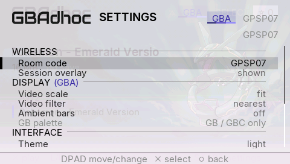 Marquee, light, Emerald |  the hero's bake |
| 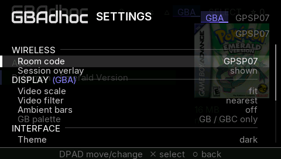 Shelf, dark, Emerald |  the cover's bake |

| fallback and other consoles | |
|---|---|
| 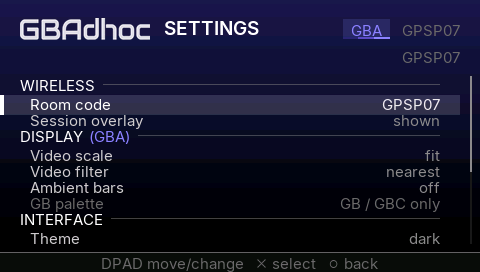 no art (AW2), dark: GBA ramp | 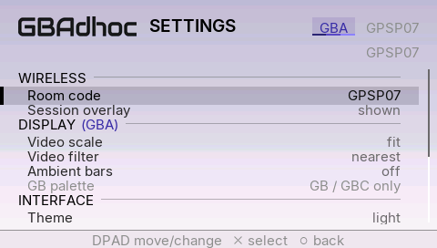 no art, light |
| 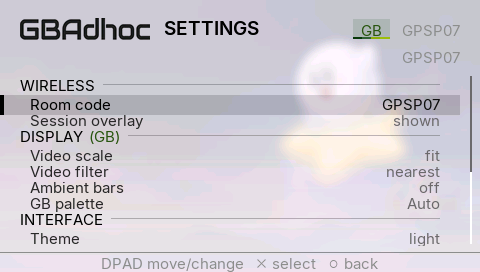 GB (Kirby's Dream Land), hero | 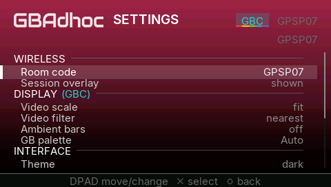 GBC (Crystal), Shelf, no cover: GBC ramp |

The §2.3 browser images are now the new look.

### 11.1 Verification

* PPSSPP GE dumps, harness EBOOTs of base 53bca1d and this branch. A
  `ui_browser_script` opens Settings, Controls, Controls' reset prompt, and
  Settings scrolled to GAMEPLAY on Emerald (art). It then opens Settings and
  Controls on AW2 (no art), Settings and Controls on GB Kirby, and Settings on
  GBC Crystal. Last, it picks AW2. Shelf and Marquee, dark and light:
  `builds/browsebg-out/runs-{base,new}/<shell>-<theme>/`, sheets in
  `builds/browsebg-out/sheets/`.
* In-game identity: `ui_demo` (real game-frame backdrop, dark; harness
  backdrop, light) and `ui_controls_demo` (both themes), base against this
  branch. The GE dumps are **48/48 byte-identical**
  (`builds/browsebg-out/runs-g{base,new}/`).
* Walkers: `ui_controls_demo = 2` (browser) dumps `ge_ctlb_0/1` over the
  ramp, and the `ui_browser_script` above runs to its pick.
* Host: `python tools/run_host_tests.py` 30/30.
* Playable EBOOT, "GBAdhoc 3.1 RC-ALL+UI" (release profile, commit 1d1cfbb,
  clean tree): `builds/browsebg-out/release/EBOOT.PBP`, md5
  `39284c3b67f288cadaad6dee00e06733`, sha256
  `75f3cd92610718482ba08bc1b0d7665a2361d349811d03bcbadaa18d3a766490`. The ME
  module is unchanged (`ee405223...`). It boots in PPSSPP.
* **Owner's eyes on hardware:** the strength of the scrim over the art on a
  real LCD, in both themes.

---

## 12. Boot splash, refined logo, header order, rooms (`claude/splash-logo`, 2026-10-02)

> **The boot splash was removed on 2026-10-03 (owner decision, §12.9).**
> §12.2 and the splash rows of §12.1 / §12.7 are kept as the record of what
> was built and measured; nothing in the tree draws, loads or ships a splash
> any more. Everything else in this section is current.

Four owner-approved changes from Fable's splash and logo study
(`builds/splash-mockups/`, README there; published as
https://claude.ai/artifact/978uXdzKLEQDRPDgpUxwmG), plus the animated XMB
icon. Base: `claude/candidate-3.1-all` 77aaabb (the 3.1.0 beta source).

### 12.1 What changed, by file

| file | change |
|---|---|
| `psp/ui_psp.c` | **Boot splash** (`ui_splash_begin`, `splash_*`): Direction D, "Ambient". **Header row** shared by the browser shells, the loading screen and the splash (`HDR_*`, `hdr_card`, `hdr_ring`): the console card moved to the right edge. Room shown as "Room 7" (`room_label`), the duplicate room line under the menu header removed, Settings row "Room code" renamed "Room". |
| `psp/video_psp.c/.h` | `vid_splash_load/draw/drop` (the texture in the ambient VRAM slot). `vid_logo` samples GU_NEAREST; `VID_LOGO_W/H` 151x24, held to the atlas by a static assert. `vid_text_a` / `vid_text_hd_a`: text with a vertex alpha (the splash fade). |
| `psp/main_psp.c` | `ui_splash_begin()` right after `vid_set_mode()`. Harness runs skip it unless `.gpsp-harness.ini` says `splash = 1` (show) or `splash = 2` (show and GE-dump every frame as `log/ge_splash_N.bmp`). The session chip, toasts and the connecting frame say "Room 7". |
| `psp/room_label.h` | THE place the on-screen room name is made: `ROOM_LABEL_WORD "Room"`. |
| `psp/logo_ui.h` | The grid-snapped 151x24 wordmark (4 px stems), byte-identical to Fable's `logo_ui-151x24-hint4.h`. |
| `psp/assets/` | `gbadhoc_icon0.png` (dark, "tuned": 3 px letters, five separable 2 px arcs, no beads), `gbadhoc_pic1.png` (dark), **new** `gbadhoc_icon1.pmf`, `splash-dark.565` / `splash-light.565`. |
| `tools/bake_logo.py` | Rewritten: bakes `psp/logo_ui.h` (and with `--xmb` ICON0/PIC1) from the 2x master through `tools/logo/logomark.py`. The old one cropped a band of PIC1 that is now the tagline. `--check` proves the committed atlas reproduces. |
| `tools/logo/` | `logomark.py` (Fable's mark, master path made local), the master PNG, `bake_splash.py` (the .565s), `make_icon1.py` (ICON1.PMF: frames, x264, our own PSMF muxer), `pmf_inspect.py`. |
| `tools/build.sh` | Release profile passes `PSP_EBOOT_ICON1`; `--out` also stages the two .565 files. Harness profiles keep their still icons. |
| `tools/make_release.sh` | Copies the .565 files next to the EBOOT. |
| `tools/ui_model/` | `splash_model.py` (the splash and header through pspdraw, and the alignment check over PPSSPP dumps); `overlay_model.py` follows the new logo and room text. |

### 12.2 The splash

**The launch screen is the loading screen** (Fable's recommendation D):
the L2 chrome (wordmark, console card, busy ring, the console's full name as
the hd title, stage line, amount, 3 px bar, footer ramp) over a 120x68 bake
of the rainbow arcs, magnified by the GE exactly as a hero's bake is at ROM
load. Missing `.565` file: the same chrome on the plain theme page.

| first frame, dark | first frame, light, GBC |
|---|---|
| 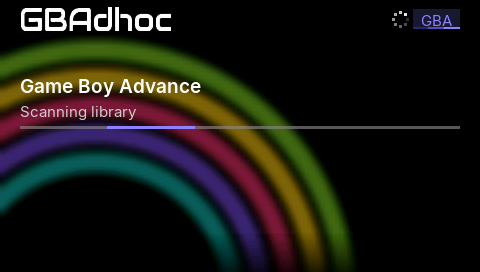 | 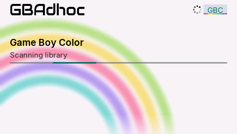 |

**Sequence** (revised after the owner's first look on the Go, below).
`ui_splash_begin` runs first in `main()`: after the exit callback, the clock
and the paths, before anything reads the stick in bulk. It starts an
animation thread that fades the splash in from black (267 ms) and keeps the
ring and bar moving while `main()` boots. `rom_scan` feeds it "Scanning
library / N games". `ui_browser` takes the GU back and shows "Library
ready" with the bar full. The browser loop then holds the splash until
1.5 s after its first frame, or longer if boot took longer, and fades it out
over 16 frames (alpha 255 → 0). Once the fade-in is done, any button skips
the rest of the hold. Input is swallowed while the splash is up. All the
timings are constants in one place (`SPLASH_*`, `psp/ui_psp.c`):

| constant | value | what |
|---|---|---|
| `SPLASH_FADEIN_US` | 267 000 | fade in from black (16 frames) |
| `SPLASH_MIN_US` | 1 500 000 | minimum on screen, from the first frame |
| `SPLASH_FADE_FRAMES` | 16 | fade into the browser |
| `SPLASH_ANIM_PRIO` / `_STACK` | 0x1E / 32 KiB | the animation thread |

| fade-in: first frame | fade-in: middle | fade-in: done |
|---|---|---|
|  | 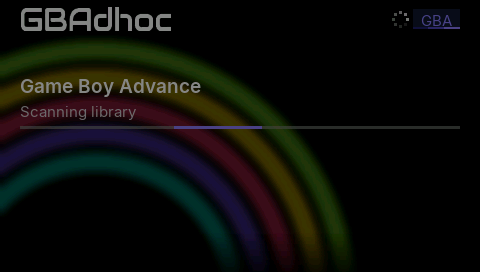 | 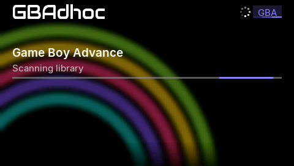 |

**The fade is split at the header row (y < 34).** Below it the splash layer
is drawn over the shell, so the list and art fade in. In the header row it
is drawn *under* the shell's header (each shell calls `splash_layer(0)`
right after its background), so the wordmark and the card, which both
screens draw at the same pixels, are never faded. The browser's own header
pieces (△, SELECT, the favourites pill, "N games") fade in with
`vid_text_a`; the ring fades out.

| fade midpoint, Shelf, dark | fade midpoint, Marquee, light |
|---|---|
| 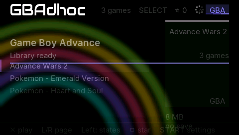 | 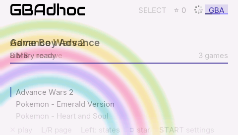 |

**Memory: no heap.** The texture is read through a 2 KiB stack buffer into
the ambient slot's 32 KiB of VRAM. Nothing uses that slot before ROM load,
and the ROM's bake simply overwrites it. The theme and console come from
`splash_peek_config`: one `sceIoOpen`, a 1 KiB stack buffer, no stdio.
The animation thread's 32 KiB stack is user-partition memory *outside* the
heap (the 1 MiB `PSP_HEAP_SIZE_KB(-1024)` leaves for stacks), and it is
returned when the thread is deleted, before the browser draws. newlib takes
its heap block at the first malloc, sized from whatever is free then, so
`splash_heap_first()` makes sure that has happened before the thread
exists; otherwise the stack would come out of the heap's share for good.
Only one thread draws at a time: any `vid_overlay_begin` / frame draw from
another thread first stops the animation (`vid_set_owner`).

Heap census, PPSSPP, harness (the 1000's 32 MiB layout), pick AW2 from the
Marquee and load it. Final build (214f941):

| run | net_arena kernel free | pre_select free | post_select free | post_load free / largest | mem_free after load |
|---|---|---|---|---|---|
| splash off | 782,336 | 15,167,112 | 15,167,112 | 1,451,176 / 966,656 | 765,952 |
| splash on (thread live at the reservation) | 749,568 | 15,167,112 | 15,167,112 | 1,451,176 / 966,656 | 765,952 |
| base 77aaabb | 782,336 | 15,175,304 | 15,175,304 | 1,459,368 / 966,656 | 765,952 |

The heap is identical at every census with the splash on and off, so every
allocation that succeeds on a 1000 still succeeds. The only difference is
outside the heap: 32 KiB of kernel-partition free memory while the thread is
alive, all of it back by ROM load (`mem_free` 765,952 in both). Against the
base the heap is 8,192 B smaller from boot. That is the binary, not an
allocation.

#### 12.2.1 Why it was black: the boot timeline

The owner, on the Go with 20174d22: *"it sits on a black screen while the
drive activity light flashes, and then the splash screen appears briefly,
barely a second or two, before the browser takes over."* Measured with a
new `EVT boot_timeline` (µs since `main()` entry / `fe_ini_get` calls /
calls that found no file, at each stage), on a harness build with no
harness ini (so it boots like a release). PPSSPP's I/O timing is not the
stick's, so the PPSSPP times give the order; the hardware column uses the
consoles' own measured negative-lookup cost (`EVT msstat`: median
**13.2 ms on the Go**, 48 samples; 13.6 ms on the 3000, 72 samples;
PPSSPP gives 1 ms) and assumes an open-and-read costs at least that.

| stage | what runs | INI calls | PPSSPP | hardware estimate |
|---|---|---|---|---|
| before `main()` | the firmware loads the 2.1 MB EBOOT and its PRX, after the XMB's own fade | - | - | ~0.3-0.7 s, unavoidable |
| entry | exit callback, 333 MHz, paths (harness builds also open the log: the 174 ms here) | 0 | 174 ms | a few ms in a release |
| **first frame** | 1 stat (harness ini), `splash_peek_config` (1 open), `vid_init` (1 vblank), the texture (1 open + 9 reads), thread start | 0 + 1 open | +48 ms | **~60 ms** |
| config | `pcfg_load` | 74 | +854 ms | 74 x 13-20 ms = **1.0-1.5 s** |
| browser | netdrv reservation, `vid_set_mode`, audio, every harness key, 4 msstat probes, `rom_scan` | +128 (127 misses) | +1.3 s | release: 127 misses gone (below); probes ~55 ms; scan by library |

**20174d22 drew its first splash frame after `pcfg_load`**: 74 separate
opens of CONFIG.INI (`fe_ini_get` has no cache), about 1.0-1.5 s of drive
activity on a black screen, after the firmware's own load. That is the black
screen. It then held only 500 ms from that frame. The splash now comes
before `pcfg_load`, about 60 ms after `main()` is entered, and fades in
while those reads run.

**127 negative lookups removed from every release boot.** In a release the
harness ini is ADR-0067's impossible path, but each of `main()`'s ~130
harness keys still asked the stick for it: up to 127 x 13 ms ≈ 1.7 s, under
the splash, on every launch. The harness build without an ini counts 127
misses; the release compiles a few of those blocks out, so it is at most
that. The release now registers that path with `fe_ini_never()`. The call
sites still run (one code path); they return the default without touching
the stick. `file_exists()` still checks for the file.

So on the Go: black for the firmware's load plus ~60 ms; the fade-in; then
the splash holds while the boot work and the ROM scan run, at least 1.5 s
from its first frame; then the 16-frame fade. `pcfg_load`'s 74 opens are
gone too: CONFIG.INI is now read once (§12.8).

### 12.3 The header row: the console card moved

Owner's adjustment to the design: the browser header swaps the console card
and the SELECT/favourites chip, so the card is the rightmost thing in the
row, right-aligned to x=460 at y=9 on every screen that has it: the browser
(both shells), the loading screen and the splash. △ stays on the card, its
left; the loading screen and splash keep their busy ring in that place. The
wordmark is at (20, 7) on all of them (the 24-row mark centred on the
20-row card: 7 + 12 = 9 + 10). The Shelf drew it at y=8 and the Marquee and
loading screen at y=10.

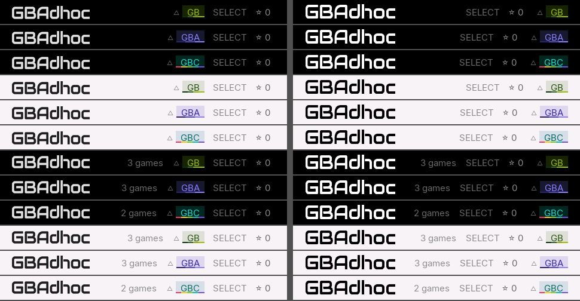

*Left: base. Right: this branch. Shelf then Marquee, dark then light, GB /
GBA / GBC.*

**The alignment proof** (re-run on 214f941, with the fade-in and the
1.5 s hold). PPSSPP GE dumps, harness `splash = 2`, all twelve
combinations (Shelf/Marquee x dark/light x GBA/GB/GBC). For each, the
wordmark box (20,7,151,24) and the card box (460-w, 9, w, 20) are compared
between the last opaque splash frame and the first browser frame after the
fade: **0 differing pixels in all 24 boxes**. The same boxes are
byte-identical in **every** dump of each run from the end of the fade-in
on (20 frames: the fade-in's first full frame, "Library ready", the hold's
last frame, all 15 fade frames, the browser after it). The fade-in dumps
before that are the same pixels under the black ramp. So the wordmark and
the card do not move or flicker at any point. The pspdraw model
(`splash_model.py`) also gives 0 for the model pair, and agrees with PPSSPP
inside the boxes to within one 565 step (float vs the GE's integer blend).

```
python tools/ui_model/splash_model.py ../splash-out/model2 --ge ../splash-out/runs-new3
```

### 12.4 The logo

`psp/logo_ui.h` is the grid-snapped bake: 151x24, every stem exactly 4 px,
cap/x-height/baseline on whole rows, 6 % mid-grey edge pixels (the 130x22
bake had 27 %), interior coverage 1.0 (was 0.85). The rainbow "dots" were
beads drawn in the old master; the refined master redraws the arcs
analytically with butt caps, so ICON0, PIC1 and ICON1 have none. The atlas
is still a 256x32 T8 texture: 8 KiB of .rodata, unchanged.

`vid_logo` samples GU_NEAREST, like the text (the atlas is drawn 1:1, so
linear could only blur it; §2.2's "logo edge" disagreement is gone).

Callers: the browser shells, the loading screen and the splash use the
header row above. The in-game menu header (`ov_head`) and the wake overlay
draw it at y=17 (was 18), keeping the old mark's centre row (29); the
screen title follows the new width (x = 20 + 151 + 14).

`tools/bake_logo.py` reproduces the committed atlas byte for byte
(`--check`), and with `--xmb` writes ICON0 and PIC1 identical to Fable's
`icon0-dark-tuned.png` and `pic1-dark.png`.

### 12.5 The animated XMB icon (ICON1.PMF)

Fable's storyboard: 144x80, 90 frames at 29.97 fps (3 s), looping. The
letters are always there; the five arcs sweep in, innermost first
(0.2-1.0 s); the bar wipes (1.0-1.4 s); hold; arcs and bar fade over the
last 0.4 s, so the loop closes on the letters alone. Dark, like ICON0 and
PIC1. The XMB plays ICON1 only while the icon is highlighted; ICON0 is the
still. Release EBOOT only: rig EBOOTs keep their still icons.

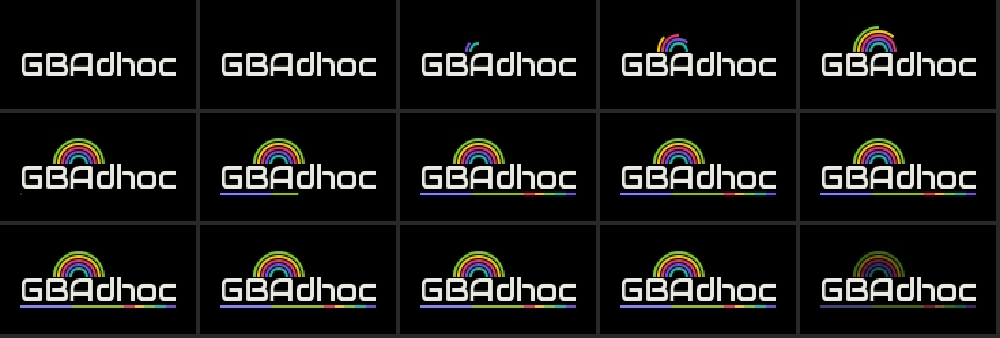

*Every 6th frame, decoded back out of `gbadhoc_icon1.pmf` by ffmpeg.*

**Toolchain** (`tools/logo/make_icon1.py`, reproducible: two runs give the
same md5). The frames are rendered from the refined mark, then x264 (via
ffmpeg) and a PSMF muxer written in the script. It needs no Sony tool. The
container is modelled byte for byte on a Sony-authored 144x80 PSMF, the
one pspautotests' `tests/video/*/test.pmf` carries (its expected outputs
were recorded on a real PSP), measured with `tools/logo/pmf_inspect.py`:

* **H.264:** Main profile, level 2.1, CABAC, I and P only (POC type 2), one
  reference frame, full-range BT.601, VUI 29.97 fps with fixed frame rate,
  NAL HRD and pic_struct. Each access unit is AUD, SEI (buffering period on
  an IDR, picture timing on every frame), then the slice. SPS/PPS repeat on
  each IDR, and x264's own banner SEI is removed. All of these match the
  reference.
* **Program stream:** 2048-byte packs at mux rate 25000. Each GOP starts
  with a pack holding the system header, a private_stream_2 table of the
  GOP's access-unit sizes, and a video PES with PTS, DTS (PTS - 3003) and a
  P-STD extension. Every other pack is one video PES, and padding closes a
  GOP. The first pack's PES header is byte-identical to the reference's.
* **Header:** "PSMF0014", the reference's fields, 144/16 x 80/16 at 0x8E,
  the first and end timestamps and the data size.

**Verified:** ffmpeg finds 90 frames, 144x80, h264 Main, level 21, 29.97
fps, full range, start 1.0 s, and decodes them at 30-35 dB PSNR against the
source frames (the loss is 4:2:0 chroma on thin arcs; CRF 8 gives the same).
PPSSPP's emulated `sceMpeg` (pspautotests `pmf_simple.prx`, with this file
as its test.pmf) registers the stream, reads offset 0x800 / size 0x4000 /
last timestamp 0x57F4E, and gets and decodes 60/60 access units with
return 0, as it does the reference. PPSSPP's game list does not animate
ICON1 headless (its game-info screen plays one through FFmpeg, which adds
nothing to the ffmpeg check). **It needs a look on a real PSP's XMB.** A
PMF the firmware rejects only means no animation: ICON0 stays up.

### 12.6 Rooms: "Room 7"

The ad-hoc group id is untouched: CONFIG.INI still says `group = GPSP07`,
and that string is what `sceNetAdhocctl` creates, scans and joins, so older
GBAdhoc builds still find a newer one's room. Only what is drawn changes,
through `room_label()` (psp/room_label.h): `GPSP07` → "Room 7", no leading
zero. Any other group (a hand-edited config, another game's room answering
a scan) is shown verbatim. Sites: the menu header chip (`ov_cluster`), the
Settings row (renamed "Room"), the Wireless screen ("Join room", "DPAD
change room", "must be in the same room."), the scan list, the connecting
frame, the toasts ("Hosting Room 7", "Room 7 not found - ..."), and the
session chip / Wireless status ("hosting  Room 7"). Host test:
`tools/test_ui_console_filter.c` (run by the `gb` suite).

**Duplicate room line.** Settings and Wireless printed the group id a second
time, right-aligned at y=48 under the header cluster. Removed; the cluster
keeps it.

| before | after |
|---|---|
|  | 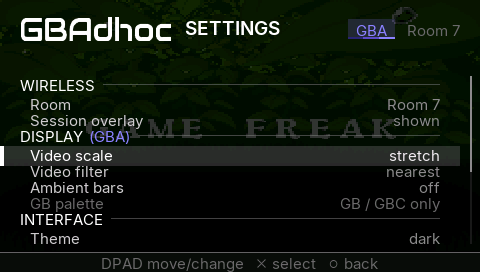 |
| 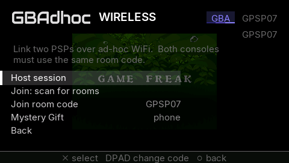 | 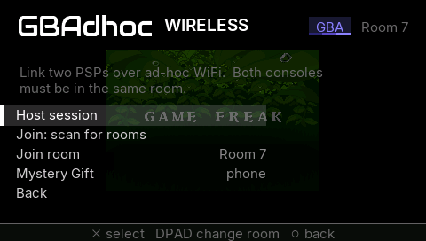 |
|  |  |

### 12.7 Verification

* Host: `python tools/run_host_tests.py` 30/30 (`fe_ini_bounds` now also
  covers `fe_ini_never`).
* PPSSPP GE dumps (Xvfb :136, private namespaces), harness EBOOTs:
  `builds/splash-out/runs-{base,new}/<shell>-<theme>-<console>/` (browser
  and splash, 12 each), `builds/splash-out/ingame-{base,new}/` (`ui_demo`
  in-game menu / Settings / Wireless, `ui_controls_demo = 2` Settings from
  the browser), `builds/splash-out/mem/` (heap census), sheets in
  `builds/splash-out/sheets/`.
* Release EBOOT sections against a base release built with the same title:
  PARAM.SFO identical; ICON0 and PIC1 are exactly the new PNGs; ICON1 is
  exactly `gbadhoc_icon1.pmf` (18,432 B; base has none); PIC0/SND0/DATA.PSAR
  empty in both; DATA.PSP differs (the code). Harness EBOOTs: ICON1 empty.

**Emulation untouched.** Guest-state frame hashes (`shash`, `c=` excluded),
harness EBOOTs of 77aaabb and this branch (re-run on 214f941), PPSSPP; the splash is skipped in
these runs (no `splash` key), as it is in every rig run.

| run | frames | result |
|---|---|---|
| AW2 tour (aw2.st0 + aw2_psp_script) | 6061 | **identical** |
| H&S heavy battle (heart_soul_heavy.st0 + battle.txt) | 3200 | identical from the state load (frame 30) on; frames 11-30 differ **exactly as two base runs differ from each other** (boot noise, §5) |
| Emerald (emerald_3000.st0) | 2000 | identical from frame 30 on; frames 4-30 differ as two base runs do |

**Playable build** ("GBAdhoc 3.1.0 beta", release profile, commit 9357d35,
clean tree, with §12.8): `builds/splash-out/release3/`, EBOOT md5
`76202ab9c27df83005e18393d6f1fdc1`; against `release2` below only DATA.PSP
differs, and the PRXs and .565 files are unchanged.

Previous build (commit 214f941): `builds/splash-out/release2/`. It boots in PPSSPP (no harness:
ran until killed). Against the owner's 20174d22 (`builds/splash-out/release/`,
1236bc9), only DATA.PSP differs; PARAM.SFO, ICON0, ICON1 and PIC1 are
byte-identical. The binary audit passes (no badjump/smchisto/irqchk/
home_stall_frame strings, `.playable-no-harness` present).

| file | md5 |
|---|---|
| `EBOOT.PBP` | `e8a8ccb1f7f1d21f2e4a0d4bee27f65e` (20174d22 was the first look) |
| `gbadhoc_me.prx` (unchanged from the base release) | `19ae57b6d21f5d1c3545bf07ff516a4c` |
| `gbadhoc_home.prx` (unchanged) | `d3434f4fd02260583c2e97ce7fe757e6` |
| `splash-dark.565` (ships beside the EBOOT) | `9615391f8097d4a8823c5c7cbe1d52df` |
| `splash-light.565` (ships beside the EBOOT) | `ee591895eef1604044ac2c4007541fdd` |
| ICON1.PMF inside the EBOOT (`psp/assets/gbadhoc_icon1.pmf`, 18,432 B) | `555e661508a008ab38644133af2fb4d2` |

**Owner's eyes on hardware:** the splash on a real LCD (both themes, the
arcs' strength under the scrim), the fade's smoothness, the new wordmark's
weight at arm's length, and ICON1 on the XMB.

### 12.8 CONFIG.INI: read once, written once, atomically (`fe_ini_doc`)

§12.2.1 found the boot's black screen in `pcfg_load`: 74 opens of
CONFIG.INI, because `fe_ini_get` opens, scans and closes the file for every
key. Saving was worse. `fe_ini_set` reads the whole file and rewrites it per
key, so one `pcfg_save` rewrote CONFIG.INI about 43 times (more with
remapped buttons and the display profiles). That is slow, it wears the
stick, and a power cut in the middle could leave a half-written file.
Owner-approved fix:

**An in-memory document** (`frontend-common/fe_util.h`, `fe_ini_doc`): load
once, get/set, save once. The struct holds an 8 KiB buffer
(`FE_INI_DOC_CAP`; CONFIG.INI is 1.2-1.4 KiB today) and lives on the
caller's stack, so there is no heap and no BSS. It is the same reader and
writer over a buffer, byte for byte:

* **get** walks the buffer in exactly the pieces `fgets(line, 512)` gave the
  old reader (so a line over 511 bytes splits the same way) and parses each
  with the old code.
* **set** applies `fe_ini_set`'s rule to the buffer. The first line whose
  key, after leading blanks, is followed by blanks and '=' becomes
  `key = value\n`; otherwise the line is appended. Comments, blank lines,
  unknown keys, order, CR LF on untouched lines and later duplicates are
  kept.
* **overflow:** a file over the cap does not load, and nothing is saved
  over it (`config_save_refused`). A set that would not fit is refused and
  leaves the document unchanged. A key is never dropped or truncated to
  make room. (The old writer refused any file of 4,095 bytes or more; the
  document holds twice that.)
* **bind:** while a document is bound to a path, `fe_ini_get` / `fe_ini_set`
  of exactly that path use it. So `pcfg_load`, `pcfg_save`, `ctl_load_ini`
  / `ctl_save_ini`, the display profiles and `pcfg_fps_x100` are unchanged
  call for call. HARNESS_INI is never bound: harness reads are exactly as
  before.

**Who uses it.** `main()` loads CONFIG.INI into a document once, before
the splash. It takes the splash's theme and console from it, and hands it
to `pcfg_load_doc`. `pcfg_save`, `pcfg_display_save`, `pcfg_remember_rom`
and `pcfg_remember_console` each do one load, their sets and one save. A
save writes nothing when no value changed a byte. `gblink_delay`, the one
CONFIG.INI key `main()` read itself, is now read inside `pcfg_load` too
(`g_pcfg.gblink_delay_cfg`). The splash's own config peek is gone.

**The atomic save, without trusting rename to overwrite.** Whether the
PSP's FAT driver replaces an existing target on `sceIoRename` is not
something to bet a config on, so it is never asked to:

| step | on the stick afterwards | if the power goes here, the next boot reads |
|---|---|---|
| 1. remove a leftover `config.ini.bak` | old | old |
| 2. write `config.ini.tmp`, flush, close | old + tmp (complete) | old (tmp ignored) |
| 3. rename `config.ini` → `.bak` | bak (old) + tmp (new, complete) | **new**: `fe_ini_recover` renames tmp → config.ini |
| 4. rename `.tmp` → `config.ini` | new + bak | new |
| 5. remove `.bak` | new | new |

`fe_ini_recover` runs only when `config.ini` itself is missing, so a normal
boot pays nothing for it. With a `.bak` present, the `.tmp` beside it is
complete, because the old file is moved aside only after the new one was
written and closed. Without a `.bak`, a `.tmp` is a first save that never
finished, may be a fragment, and is deleted, never used. If a rename fails,
the old file is put back and the new one written in place (once, the old
way) with `config_save ... in_place=1` logged. Either way, a power cut
leaves the old file or the new one, never a broken one.

**Verified.**

* Host (`fe_ini_bounds` suite, `tools/tests/test_ini_doc.c`, 874,655
  checks):
  * 3,000 random files with every trap the old code has an opinion on
    (CR LF, comments, sections, blanks around '=', duplicates, lines over
    511 bytes, no final newline), plus the two real configs below.
  * `doc_get` == `fe_ini_get` for every key; random edit sequences give
    `doc_set` == `fe_ini_set`, byte for byte, as file contents and return
    codes.
  * An unchanged document is never rewritten.
  * Overflow at exactly the cap; every power-cut state in the table;
    1 open per `pcfg_load` and per `pcfg_save`.
  * `test_display_profiles`: the TRIANGLE display save is now 1 read and 1
    write (was 4 rewrites), and a load is 1 read.
* **A 3.0.0 and a 3.1 beta CONFIG.INI** (`tools/tests/fixtures/`, copies of
  a 3.0.0-RC Go stick and the Go's pre-splash beta stick):
  * Built twice against the same `config_psp.c`, the new path and
    `-DFE_INI_DOC_LEGACY` (bind is a no-op, so every key goes to the file
    as before). `pcfg_load` gives identical `g_pcfg` and `g_pdisp`, every
    byte.
  * A `pcfg_save` with settings changed (theme, FF hold, room, a GB
    profile), then `pcfg_remember_rom` and `pcfg_remember_console`, writes
    an identical file (1,377 B and 1,395 B).
* PPSSPP, harness builds, base 77aaabb against this branch: `ui_demo` saves
  Settings in game and `ui_controls_demo = 2` saves them from the browser.
  The CONFIG.INI each leaves is **byte-identical** to the base build's
  (md5 `4e061bd6…`, `44b2f6e3…`). No `.tmp` or `.bak` is left, and no
  rename fell back.
* Boot timeline (harness, no ini): the CONFIG.INI stage is now **0 extra opens and 1 ms**
  (was 74 opens, 854 ms in PPSSPP). The one read happens before the
  splash, and 77 lookups are answered from it:

  ```
  before: entry=174070/0/0 splash=222243/0/0 config=1076391/74/0 ... browser=2376773/202/127
  after:  entry=174070/0/0 splash=222243/1/0 config=223224/1/0  ... browser=1512059/128/127 doc_hits=77
  ```

  The 127 misses that remain are this harness build's own harness keys;
  the release skips them (`fe_ini_never`). On hardware the 74 opens were
  ~1.0-1.5 s (§12.2.1); every launch now saves that, plus the 43-odd
  rewrites per Settings save.
* Heap census (harness, AW2 from the Marquee): splash on and off identical
  again. Against the base, `pre_select` is 16,384 B lower
  (15,158,920 vs 15,175,304) and `post_load` 1,442,984 vs 1,459,368. That
  is code: `.text` +10 KiB over 77aaabb across all of §12, rounded to the
  module's pages, with `.data` and `.bss` unchanged. The document itself is
  on the stack, and `mem_free` after load is the same 765,952.
* Guest-state frame hashes against 77aaabb: AW2 6061 frames identical;
  H&S and Emerald identical from the state load on (frames before it differ
  as two base runs do, §12.7).
* Host: 30/30.

### 12.9 The boot splash removed (owner decision, 2026-10-03)

On real hardware the splash showed for only a moment after the long black
screen of the firmware's own EBOOT load, and because "Quit to game list"
relaunches the EBOOT, it came back every time a game was quit. The owner
asked for it to go; the rest of the branch stays.

**Removed** (commit 59b2b01): `ui_splash_begin` and every `splash_*`
function, the animation thread and the GU-ownership hook it needed
(`vid_set_owner` / `vid_claim`, one test per draw), `vid_splash_load /
draw / drop`, `vid_text_a` / `vid_text_hd_a` (only the splash fade used
them; the browser header is back to `vid_text`), the `SPLASH_*` constants
and `HDR_SPLIT`, the harness `splash` key, `psp/assets/splash-{dark,light}.565`
and their copying in `tools/build.sh --out` and `tools/make_release.sh`,
`tools/logo/bake_splash.py` and `tools/ui_model/splash_model.py`. `main()`
calls `vid_init()` after the netdrv reservation again, as 77aaabb did.

**Kept:** the 151x24 wordmark drawn GU_NEAREST, ICON0 / ICON1.PMF / PIC1,
the card-right header row (`HDR_*`, `hdr_card`, `hdr_ring` without the fade
alpha), "Room 7" and the removed duplicate room line, `fe_ini_never`, and
§12.8: CONFIG.INI is still loaded once, first thing in `main()`, into
`cfg_doc` for `pcfg_load_doc`, and saved in one atomic write. The boot
timeline EVT stays (telemetry builds only) without its `splash` mark.

**No release path references a splash file.** `git grep -i splash` over
`psp/`, `frontend-common/`, `tools/build.sh` and `tools/make_release.sh`
finds nothing. The linked release ELF and its EBOOT contain no `splash`,
`565R` or `ge_splash` bytes (release3 had 4 / 2 of them); the one `.565`
string left is the hero/box-art cache path (`%s/%s/%.*s.565`, §3), which is
older than this branch. `make_release.sh` packages EBOOT.PBP, the two PRXs,
VERSION, README, LICENSE and the empty folders, and nothing else.

**Verification** (harness EBOOT of the removal vs the splash build f73d5fa
and the base 77aaabb, PPSSPP on Xvfb :142):

* Host: `python tools/run_host_tests.py` 30/30.
* Frame identity (`shash`, `c=` excluded): AW2 tour 6061 frames identical
  to both; H&S heavy battle and Emerald identical from the state load on,
  with frames 11-30 / 4-30 differing exactly as two base runs differ.
* Heap census, 1000 layout, pick AW2 from the Marquee and load it:

| build | net_arena kernel free | pre_select free / largest | post_load free / largest | mem_free after load |
|---|---|---|---|---|
| base 77aaabb | 782,336 | 15,175,304 / 15,167,488 | 1,459,368 / 966,656 | 765,952 |
| splash f73d5fa (splash off) | 782,336 | 15,158,920 / 15,151,104 | 1,442,984 / 966,656 | 765,952 |
| **removal** | 782,336 | 15,167,112 / 15,159,296 | 1,451,176 / 966,656 | 765,952 |

  The removal gets back 8,192 B of heap from the smaller binary; every
  allocation's shape is unchanged.
* Release audit (`tools/build.sh release`): no badjump/smchisto/irqchk/
  home_stall_frame strings, `.playable-no-harness` present. It boots in
  PPSSPP with no harness and runs until killed.

**Playable build** ("GBAdhoc 3.1.0 beta", release profile, commit 59b2b01,
clean tree): `builds/splash-out/release4/`.

| file | md5 |
|---|---|
| `EBOOT.PBP` | `5a82ef577da909693a0ebd6adcdf5d55` |
| `gbadhoc_me.prx` (unchanged) | `19ae57b6d21f5d1c3545bf07ff516a4c` |
| `gbadhoc_home.prx` (unchanged) | `d3434f4fd02260583c2e97ce7fe757e6` |

Ship those three files and nothing else; an install that still has the
old `splash-*.565` files beside the EBOOT can delete them (nothing reads
them).

---

## 13. One SAVE STATES page (`claude/savestate-ui`, 2026-10-03)

Fable's direction A, "Split" (`builds/savestate-mockups/`, README there;
the design is `savestate.py`, scenes in `A-split/` and `menu/`). Base:
c746cca (GBA-LINK-UI final). The menu's two rows "Save state" / "Load
state" and their two pages become one row, **Save states** ("n of 5 used"
beside it), and one page: the five slots on the left (64x42 thumbnail at
36x24, the slot, its time), the highlighted slot's picture **1:1** on the
right, the slot and its time under it.

| key | on a saved slot | on an empty slot |
|---|---|---|
| X | load, and the menu closes | the plate says "Slot n is empty" |
| SQUARE | the plate asks "Overwrite Slot n?"; X overwrites | save; the page stays, the plate says "Slot n saved" |
| TRIANGLE | the plate asks "Delete Slot n?"; X deletes | nothing |
| UP / DOWN | move (wraps) | move |
| O | back to the menu | back to the menu |

While a question is up, X answers it and any other key keeps the slot, and
no other key acts that frame, so an X meant for "overwrite" can never load.
The page opens on slot 1 every time, as 3.1's pages did.

### 13.1 What changed, by file

| file | change |
|---|---|
| `psp/state_slots.h` | **`<state>.shot`**: the native frame (240x160 GBA, 160x144 GB/GBC) behind the .thumb's 16-byte STH1 header (w, h, stride 256), rows stored at the texture's stride so the body is one read. `psp_state_shot_path/header/check`. The delete names three files (state, .thumb, .shot). |
| `psp/main_psp.c` | The save writes the .shot after the .thumb, 8 rows per write through a 4 KiB stack buffer, and removes it on a failed write. The `state_save` EVT times state, .thumb and .shot separately. A save from the page reports on its plate (no "State saved" toast over the header). Harness: `census TAG` ui_script verb (heap census), `shot_probe = 1` (four timed reads as the page opens). |
| `psp/video_psp.c/.h` | The preview texture: 256x256 RGB565 (131,072 B) at a **fixed** VRAM offset after sharp bilinear's full reserved extent, whether or not sharp is in use, so ambient, sharp and this can never overlap: `[display x3][depth][staging][ambient][sharp 344,064][shot]` = 1,581,056 .. 1,712,128 of 2,097,152. `vram_at()` refuses it if the eDRAM is ever smaller; the page then never reads a .shot. `vid_shot_tex/rows/draw`, `vid_image_nearest`. Zero heap. |
| `psp/ui_psp.c` | The menu (six rows, the open-time count), the page (`screen_state_slots`, `ss_panel`), the scan (`ov_slots_stat` / `ov_slots_scan`: five stats, five 5 KiB .thumb reads, once per open / save / delete), **the dwell read**: once the cursor has rested `OV_SHOT_DWELL` = 6 frames on a saved slot, its .shot is read into the texture with the core paused, and kept until the cursor or the slot changes. Until then, for a 3.1 state (no .shot) for good, and whenever VRAM refused the texture, the panel shows the 64x42 thumbnail at 2x, nearest (a 3.1 state says "saved by 3.1: small preview only"). `ss_slot` EVT per scan (telemetry builds). The demo walkers follow the six-row menu. |
| `tools/tests/test_state_delete.c` | The .shot as the third name. |
| `tools/ui_model/savestates/` | The GE rig: `make_fixtures.py` (the design's card and backdrops from Fable's assets, with mtimes), `stage.sh` (the card onto the emulated stick via `run_linkmenu_ppsspp.sh`'s new `Ii_STAGE` hook), the scene walks (`ss_{gba,gbc,gb}_t{0,1}`), `ss_mem` (heap census + VRAM tenancy), `ss_rt` / `ss_rt_gbx` (round trips). |
| `tools/ui_model/overlay_model.py`, `compare.py` | The model draws the six-row menu and the page; `compare.py` replays the page's state at each dump from the run's log (`ss_slot`, `shot_dwell`, `ui_open`). |

### 13.2 Deliberate differences from the design and the brief

* **Quick save / quick load stay on slot 1.** SELECT+L / SELECT+R always
  used slot 1 in 3.1, not "the highlighted slot" as the brief assumed; left
  unchanged (making them follow the page's cursor is a one-line change, the
  owner's call).
* **A failed load keeps the page open** and says so on the plate; a good
  load closes the menu as designed.
* **Page messages go on the plate, never a toast:** "Slot n saved", "Slot n
  deleted", "Slot n is empty" (X on an empty slot, off the legend). A toast
  sits on the header. The "State loaded" toast after a load is unchanged: it
  shows over the game, and over the menu only if it is reopened within its
  2.5 s.
* **"n of 5 used" costs five stats** once as the menu opens (`ui_open
  slots_used=N stat_us=...`).
* **The .shot is written 8 rows per write** (20 writes for GBA), not one
  write per row.
* The row thumbnails are drawn with GU_LINEAR at 64x42 -> 36x24 exactly as
  the design's call says; see 13.3 for why the PNGs look softer.

### 13.3 Verification

All PPSSPP runs: private namespaces, Xvfb :147/:148 (:124 for the walkers),
the known-good control first (the GBA-LINK-UI `ge_em_t0` walk on
`final-harness64` e8873d93: 11/11 dumps byte-identical to its earlier run).
Outputs under `builds/savestate-ui-out/` (`runs/`, `ovruns/`, sheets in
`cmp/`); the BMPs were deleted once compared.

**Against Fable's PNGs** (`compare_mockups.py`, `LINKMODE_PNG` pointed at
`A-split/` and `menu/`), harness64 `f684bb5e`, all 8 scenes x 2 themes, the
design's card staged (`make_fixtures.py`) and its backdrop injected:

| | >1-step pixels |
|---|---|
| row thumbnails (5 x 36x24) | 1,621 per GBA scene, 399 / 446 GB / GBC: the design model's `image()` downsamples with PIL BILINEAR, which widens its filter to the whole 64->36 footprint; the GE's GU_LINEAR takes 2x2 texels. A GU_LINEAR simulation of the fixture .thumb matches the dump to 13-34 px (max 2-3 steps). Same cause `compare.py` already masks. |
| everything else | 0-112 px per scene (467 in `dwell` light), **every one exactly 2 steps** (blend rounding under the 170 scrim) |
| the 1:1 preview | **0 px** against the .shot inside the 1 px outline (GBA 240x160 at 228,62; GB/GBC 160x144 at 268,70) |
| menu | the digit only: the fixtures hold 4 states where the design says 3 ("4 of 5" vs "3 of 5"; the rest of the line is 1 px right, the "4" being wider) |

**The model** (`compare.py`, harness64 `3655bc8e`, `ui_demo` both themes):
menu, the 7 opening frames and the five page scenes (3.1-state fallback +
caption, empty slot, "Slot 4 saved" with its picture landed, both questions)
match with 0 >1-LSB pixels dark and <= 21 light (max 17, 2 steps). Settings,
Wireless and the Controls page differ from the model where **the model has
not followed earlier branches** (no "Link mode" row, the GBA-LINK-UI
Wireless text, "Menu hold START+SELECT"); the walkers reach every screen.

**Memory and VRAM** (`ss_mem`, Fit + sharp bilinear + ambient "art, else
game" baked from the game, a real Emerald state, models 0 and 1): the heap
census is **identical** at pre-menu, menu open, page open, after three
dwell reads and after closing (32 MiB: free 1,574,376, largest 851,968;
64 MiB: free 14,676,040, largest 13,811,712). `sharp_target vram_off=
1236992 bytes=344064`, `shot_tex vram_off=1581056 bytes=131072
edram=2097152`. With sharp drawing the backdrop every frame and the
ambient texture live, the previews are exact and the backdrop is the
dimmed game frame (corr 0.88).

**Round trips** (`ss_rt` on models 0 and 1, `ss_rt_gbx` GB and GBC):

* save to an empty slot, 59 frames, dump A; load it, 59 frames, dump B:
  **A == B** everywhere outside the "State loaded" toast box (GBA, GB,
  GBC). Save CRCs repeat across runs (`3998f4b2`).
* a 3.1 state (no .shot) and a .shot state of the same bytes: the frames 59
  after loading each are **identical** (0 px).
* overwriting the 3.1 slot writes its .shot (the panel then shows 1:1);
  deleting slot 2 removes `.st1`, `.st1.thumb` and `.st1.shot`.
* the read, PPSSPP (I/O timing is emulated, not the stick's): ~12.5 ms for
  81,936 B, 10 ms for a missing .shot.

**Emulation untouched:** AW2 scene tour, 6,061 frames, `shash` (`c=`
excluded): **identical** to `final-harness64` e8873d93. Post-load heap
18,468,792 -> 18,460,600 (-8,192 = the image's growth).

**Host:** `python tools/run_host_tests.py` 30/30 (`test_state_delete` runs
inside the `ctl_map` suite).

**Builds** (commit 6d95484, clean tree, GBA_LINK=1, `builds/savestate-ui-out/`):

| build | EBOOT md5 | image | PSP-1000 boot heap |
|---|---|---|---|
| `final-release` (audit passes; boots in PPSSPP and runs to the timeout) | `a8fd9e0cc4dd65ca5b22db6f5cf57739` | 13,056,256 (+8,192) | 11,040,296 |
| `final-harness` | `5f2733ee1922ab9296ac056ab766603b` | 13,408,512 | 10,688,040 |
| `final-harness64` | `374a98e0b40bf82bc1b6b414dfccf62a` | 13,408,512 | 10,688,040 |

`gbadhoc_me.prx` and `gbadhoc_home.prx` are byte-identical to the
GBA-LINK-UI finals in all three.

### 13.4 What needs hardware

* The dwell read's real time on a Memory Stick against `OV_SHOT_DWELL` = 6
  frames (`shot_probe = 1` prints four `shot_read` lines as the page opens),
  and the save's extra .shot write time (`state_save ... shot_us=`).
* The 1:1 panel on the LCD, both themes; the 36x24 row thumbnails'
  sharpness (GU_LINEAR, see 13.3).
* The PSP-1000: the `net_arena` / heap lines unchanged by opening the page.
